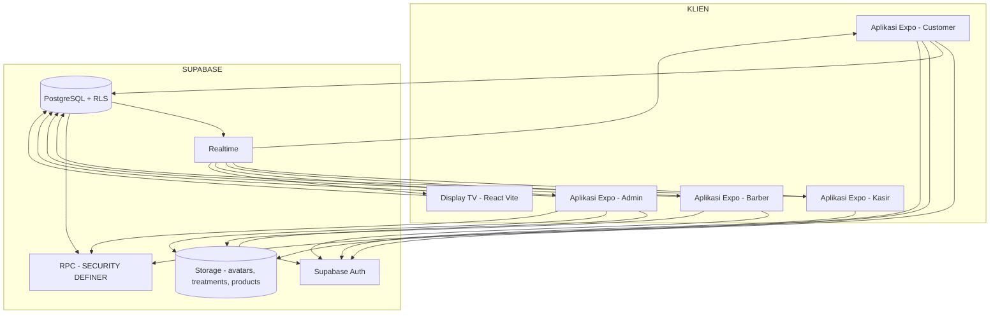
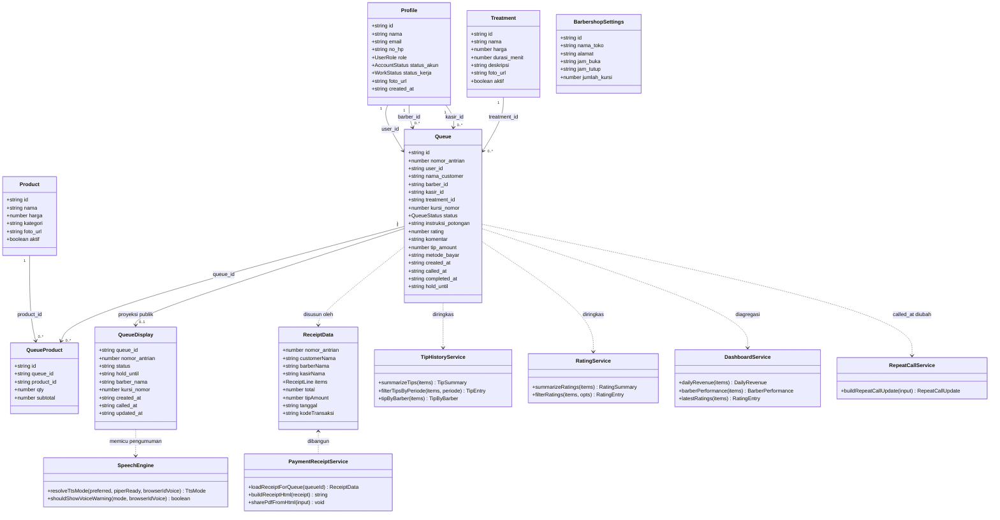
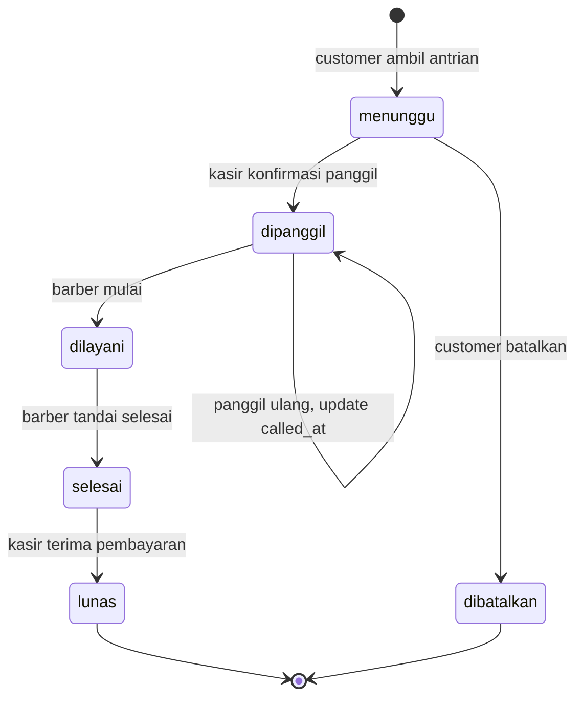
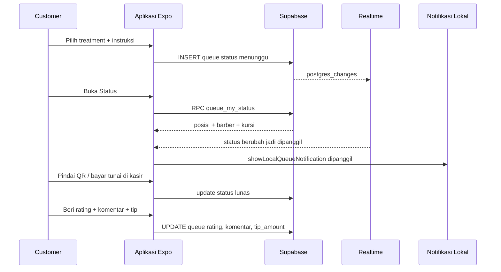
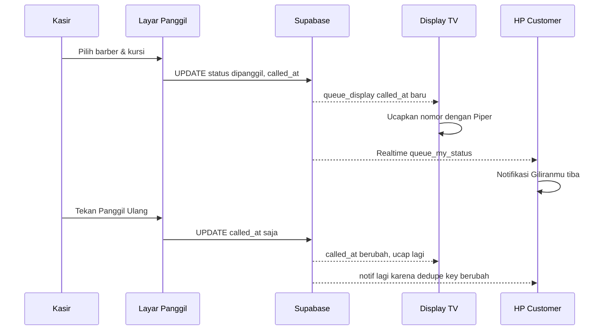
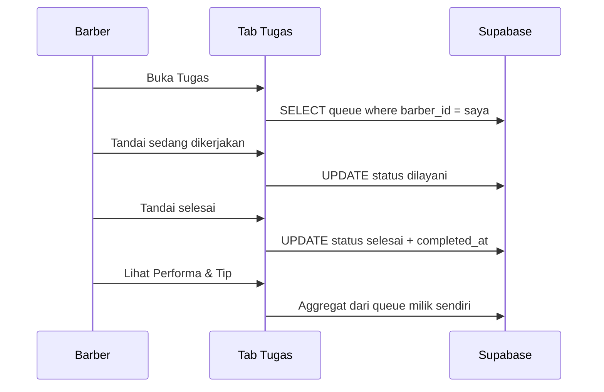
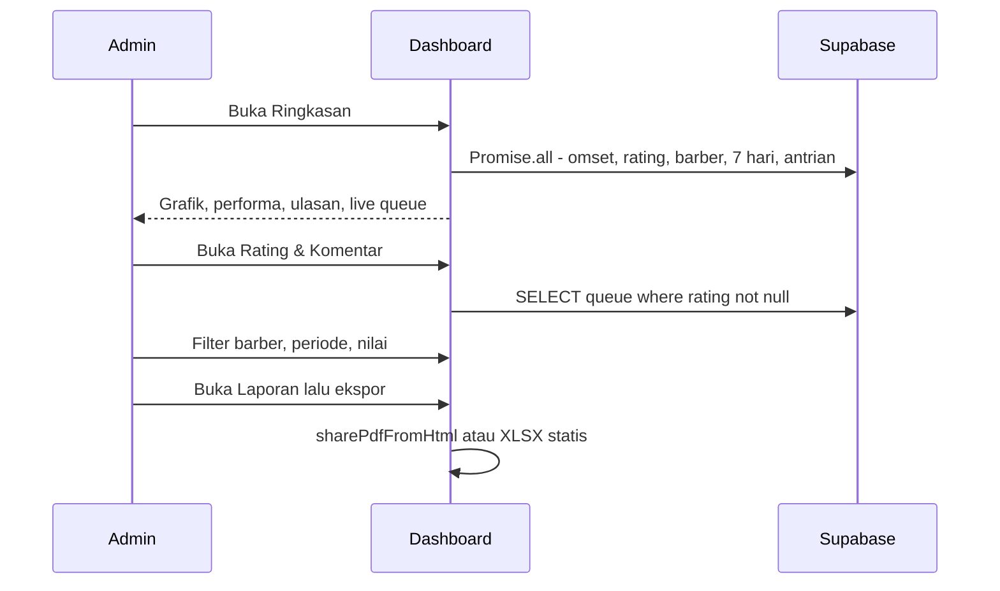
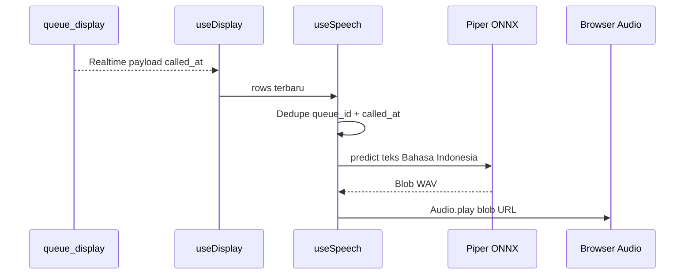
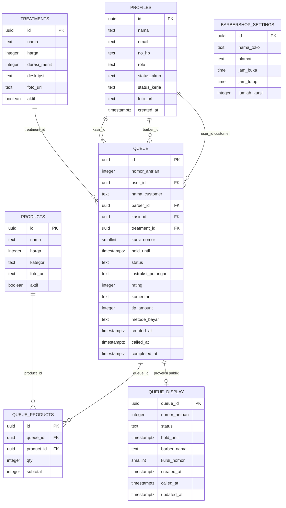

# BarberSys — Sistem Manajemen Antrian & Kasir Barbershop

> Dokumentasi teknis dan akademik lengkap untuk tugas **RPL (Rekayasa Perangkat Lunak)**.
> Repositori: `https://github.com/ALVINfrs/BarberSys-Expo.git`
> Versi dokumen: 2.0 — 24 November 2026

---

## Daftar Isi

1. [Pengenalan](#1-pengenalan)
2. [Arsitektur Sistem](#2-arsitektur-sistem)
3. [Model Domain & Class Diagram](#3-model-domain--class-diagram)
4. [Alur Bisnis Detail](#4-alur-bisnis-detail)
5. [Basis Data](#5-basis-data)
6. [Integrasi Supabase](#6-integrasi-supabase)
7. [Modul Kode & Helper](#7-modul-kode--helper)
8. [Antarmuka & Sistem Desain](#8-antarmuka--sistem-desain)
9. [Display TV & TTS Bahasa Indonesia](#9-display-tv--tts-bahasa-indonesia)
10. [Instalasi & Operasional](#10-instalasi--operasional)
11. [Pengujian](#11-pengujian)
12. [Keamanan & Privasi](#12-keamanan--privasi)
13. [Troubleshooting](#13-troubleshooting)
14. [Status Fitur & Roadmap](#14-status-fitur--roadmap)
15. [Glosarium](#15-glosarium)
16. [Referensi & Lampiran](#16-referensi--lampiran)

---

## 1. Pengenalan

### 1.1 Ringkasan Eksekutif

BarberSys adalah sistem informasi barbershop yang mengelola seluruh siklus layanan: pelanggan mengambil nomor antrian, kasir memanggil dan menugaskan barber serta kursi, barber menyelesaikan layanan, kasir menerima pembayaran tunai atau QRIS simulasi, layar Display TV menampilkan dan mengumumkan panggilan, lalu pelanggan memberikan rating, komentar, dan tip. Seluruh data tersimpan di Supabase (PostgreSQL) dengan kebijakan RLS, sedangkan pengumuman publik hanya memakai proyeksi `queue_display` yang tidak memuat data pribaya customer.

Aplikasi terdiri dari dua proyek:

| Proyek | Teknologi | Fungsi |
|---|---|---|
| `BarberSys/` | Expo Router + React Native + TypeScript | Aplikasi untuk Customer, Kasir, Barber, Admin |
| `display-tv/` | React + Vite + TypeScript + Piper TTS | Layar publik ruang tunggu |

### 1.2 Masalah yang Diselesaikan

| Masalah | Solusi BarberSys |
|---|---|
| Antrian dicatat manual di kertas | Nomor antrian digital dengan status realtime |
| Pelanggan tidak tahu giliran | Notifikasi lokal HP + Display TV bersuara |
| Barber tidak tahu tugasnya | Layar Tugas per barber dengan status otomatis |
| Kasir kesulitan melacak pembayaran | Riwayat transaksi, struk PDF, filter tanggal WIB |
| Admin tidak punya gambaran usaha | Dashboard omset, rating, performa, dan laporan ekspor |
| Tidak ada feedback pelanggan | Rating, komentar, tip, dan rekap pemberi tip |
| Suara display tidak Bahasa Indonesia | Piper lokal dengan model `id_ID-news_tts-medium` |

### 1.3 Tujuan & Non-Tujuan

**Tujuan**
- End-to-end alur antrian hingga pembayaran tanpa kertas.
- Privasi data customer terjaga lewat RLS dan proyeksi publik.
- Dapat diuji per modul dengan unit test murni.
- Dokumentasi cukup lengkap untuk dipertanggungjawabkan sebagai tugas RPL.

**Non-tujuan**
- Payment gateway sungguhan — QRIS hanya simulasi.
- Printer thermal fisik — struk berupa PDF.
- Remote push notification — hanya notifikasi lokal.
- Perubahan skema database spontan tanpa migrasi & sinkron tipe.

### 1.4 Pengguna & Persona

| Peran | Kebutuhan utama | Layar kunci |
|---|---|---|
| Customer | Cepat ambil antrian, tahu giliran, bayar, menilai | Treatment, Ambil Antrian, Status, Riwayat, Tip Saya, Profil |
| Kasir | Mengatur antrean, memanggil berulang, menerima bayar, mencetak struk | Antrian Masuk, Panggil Antrian, Pembayaran, Riwayat, Profil |
| Barber | Tahu tugas, tandai selesai, lihat performa & tip | Tugas, Riwayat, Performa, Tip, Profil |
| Admin | Mengelola katalog,pegawai, memantau usaha | Ringkasan, Rating, Treatment, Produk, Pegawai, Laporan, Profil |
| Pengunjung | Melihat antrian publik | Display TV |

---

## 2. Arsitektur Sistem

### 2.1 Diagram Arsitektur



### 2.2 Layer & Tanggung Jawab

| Layer | Lokasi | Tanggung jawab |
|---|---|---|
| Presentasi | `src/app/**`, `display-tv/src/App.tsx` | Routing, layar, interaksi pengguna |
| Komponen UI | `src/components/ui/**` | Design system tombol, kartu, badge, skeleton, ticker |
| Komponen domain | `src/components/receipt-history-screen.tsx`, `tip-summary-card.tsx`, `barber-settings-card.tsx` | UI khusus yang dipakai lintas layar |
| Hook | `src/hooks/**`, `display-tv/src/lib/use-*.ts` | Role guard, notifikasi, data realtime, TTS |
| Domain murni | `src/lib/*.ts` | Perhitungan WIB, estimasi, struk, tip, rating, dashboard, QRIS |
| Integrasi | `src/lib/supabase.ts`, `receipt-service.ts`, `share-pdf.ts` | Akses Supabase & native API |
| Backend | Supabase | Auth, Postgres, RLS, Realtime, Storage, RPC |

### 2.3 Struktur Direktori Lengkap

```text
BarberSys/
├── README.md
├── docs/
│   ├── prd .md
│   ├── design.md
│   ├── akun-demo.md
│   ├── screenshots/
│   └── superpowers/
│       ├── specs/
│       └── plans/
├── BarberSys/
│   ├── app.json
│   ├── package.json
│   ├── .env.example
│   ├── src/
│   │   ├── app/
│   │   │   ├── _layout.tsx                 Stack root + AuthProvider + ThemeProvider
│   │   │   ├── index.tsx                   Redirect berdasarkan role
│   │   │   ├── display.tsx                 Fallback Display TV
│   │   │   ├── admin-rating.tsx            Rating & komentar (Stack root)
│   │   │   ├── scan-qris.tsx               Pemindai QR customer
│   │   │   ├── (auth)/
│   │   │   │   ├── login.tsx
│   │   │   │   └── register.tsx
│   │   │   ├── customer/
│   │   │   │   ├── _layout.tsx             Tab: Treatment, Antrian, Status, Riwayat, Profil
│   │   │   │   ├── home.tsx
│   │   │   │   ├── history.tsx             Termasuk seksi Tip Saya
│   │   │   │   ├── profile.tsx
│   │   │   │   └── queue/{new,status}.tsx
│   │   │   ├── kasir/
│   │   │   │   ├── _layout.tsx
│   │   │   │   ├── call.tsx                Panggil & Panggil Ulang
│   │   │   │   └── (tabs)/
│   │   │   │       ├── _layout.tsx
│   │   │   │       ├── queue.tsx
│   │   │   │       ├── payment.tsx
│   │   │   │       ├── riwayat.tsx
│   │   │   │       └── profile.tsx
│   │   │   ├── barber/
│   │   │   │   ├── _layout.tsx             Tab: Tugas, Riwayat, Performa, Tip, Profil
│   │   │   │   ├── queue.tsx
│   │   │   │   ├── riwayat.tsx
│   │   │   │   ├── performansi.tsx
│   │   │   │   ├── tip.tsx
│   │   │   │   └── profile.tsx
│   │   │   ├── admin/
│   │   │   │   ├── _layout.tsx
│   │   │   │   ├── ringkasan.tsx
│   │   │   │   ├── treatments.tsx
│   │   │   │   ├── products.tsx
│   │   │   │   ├── staff.tsx
│   │   │   │   ├── laporan.tsx
│   │   │   │   └── profile.tsx
│   │   │   └── pengaturan/tampilan.tsx
│   │   ├── components/
│   │   │   ├── RoleHeader.tsx
│   │   │   ├── ProfileForm.tsx
│   │   │   ├── receipt-actions.tsx
│   │   │   ├── receipt-history-screen.tsx
│   │   │   ├── tip-summary-card.tsx
│   │   │   ├── barber-settings-card.tsx
│   │   │   └── ui/                         Button, Card, Text, Badge, EmptyState, dll.
│   │   ├── context/                        AuthContext, ThemeContext
│   │   ├── hooks/                          use-role-guard, useQueueNotifications
│   │   ├── lib/                            Modul domain & integrasi
│   │   └── types/database.ts               Kontrak tipe seluruh entitas
│   └── scripts/                            Unit test .mjs
└── display-tv/
    ├── index.html
    ├── package.json
    ├── vite.config.ts
    ├── .env.example
    └── src/
        ├── App.tsx
        ├── main.tsx
        ├── styles.css
        └── lib/
            ├── announcement.ts
            ├── supabase.ts
            ├── use-display.ts
            ├── use-speech.ts
            └── tts-engine.ts
```

### 2.4 Teknologi & Versi

| Paket | Versi terpasang | Kegunaan |
|---|---|---|
| expo | 58.x | Runtime aplikasi lintas platform |
| expo-router | 58.x | File-based routing |
| react / react-native | 19.x / 0.88 | UI |
| @supabase/supabase-js | 2.x | Auth, DB, Realtime, Storage |
| expo-print / expo-sharing | 58.x | Struk PDF & share sheet |
| expo-camera | 58.x | Scan QRIS |
| expo-notifications | 58.x | Notifikasi lokal |
| xlsx | 0.18.x | Ekspor laporan Excel |
| vite | 8.x | Build Display TV |
| @mintplex-labs/piper-tts-web | 1.x | Inference TTS lokal di browser |
| onnxruntime-web | 1.31.x | Runtime model ONNX |

---

## 3. Model Domain & Class Diagram

### 3.1 Class Diagram



### 3.2 Enumerasi Status



| Enumerasi | Nilai |
|---|---|
| `UserRole` | `customer`, `barber`, `kasir`, `admin` |
| `AccountStatus` | `aktif`, `nonaktif` |
| `WorkStatus` | `aktif`, `istirahat` |
| `QueueStatus` | `menunggu`, `dipanggil`, `dilayani`, `selesai`, `lunas`, `dibatalkan` |
| `DisplayStatus` | `menunggu`, `dipanggil`, `dilayani` |
| `MetodeBayar` | `tunai`, `qris`, `null` |
| `TipPeriode` | `7`, `30`, `semua` |
| `TtsMode` | `piper`, `browser`, `none` |

### 3.3 Aturan Transisi Penting

| Transisi | Aktor | Perubahan data |
|---|---|---|
| `menunggu → dipanggil` | Kasir | `barber_id`, `kasir_id`, `kursi_nomor`, `called_at` |
| `dipanggil → dipanggil` | Kasir | **Hanya `called_at`** — Panggil Ulang |
| `dipanggil → dilayani` | Barber | Status saja |
| `dilayani → selesai` | Barber | Status + `completed_at` |
| `selesai → lunas` | Kasir | `metode_bayar`, `tip_amount`, `kasir_id`, `completed_at` |
| `menunggu → dibatalkan` | Customer | Status saja |

Trigger `queue_guard_update` menolak transisi yang tidak sah, misalnya customer mengubah status sendiri menjadi `lunas`.

---

## 4. Alur Bisnis Detail

### 4.1 Alur Customer



### 4.2 Alur Kasir & Panggil Ulang



### 4.3 Alur Barber



### 4.4 Alur Admin



### 4.5 Alur Display TV & TTS



---

## 5. Basis Data

Sumber kebenaran: `docs/prd .md` §7 dan `BarberSys/src/types/database.ts`.

### 5.1 Entity Relationship Diagram

> Perbaikan: comment atribut tidak memakai karakter `|`, dan `queue_display.queue_id` memakai `PK` dengan keterangan FK.



### 5.2 Kamus Data Lengkap

#### 5.2.1 `profiles`

| Kolom | Tipe | Null | Default | Keterangan |
|---|---|---|---|---|
| `id` | uuid | NO | `gen_random_uuid()` | PK, identik dengan `auth.users.id` |
| `nama` | text | NO | — | Nama lengkap |
| `email` | text | YES | — | Email login |
| `no_hp` | text | YES | — | Nomor telepon |
| `role` | text | NO | `customer` | `customer`, `barber`, `kasir`, `admin` |
| `status_akun` | text | NO | `aktif` | `aktif` atau `nonaktif` |
| `status_kerja` | text | YES | NULL | `aktif` atau `istirahat`, khusus barber |
| `foto_url` | text | YES | NULL | URL bucket `avatars` |
| `created_at` | timestamptz | NO | `now()` | Waktu dibuat |

#### 5.2.2 `treatments`

| Kolom | Tipe | Null | Keterangan |
|---|---|---|---|
| `id` | uuid | NO | PK |
| `nama` | text | NO | Nama layanan |
| `harga` | integer | NO | Harga Rupiah, constraint `>= 0` |
| `durasi_menit` | integer | NO | Dipakai estimasi tunggu |
| `deskripsi` | text | YES | Deskripsi singkat |
| `foto_url` | text | YES | URL bucket `treatments` |
| `aktif` | boolean | NO | Soft-delete |

#### 5.2.3 `products`

| Kolom | Tipe | Null | Keterangan |
|---|---|---|---|
| `id` | uuid | NO | PK |
| `nama` | text | NO | Nama produk |
| `harga` | integer | NO | Harga Rupiah |
| `kategori` | text | YES | Misal pomade, powder, haircare |
| `foto_url` | text | YES | URL bucket `products` |
| `aktif` | boolean | NO | Soft-delete |

#### 5.2.4 `queue`

| Kolom | Tipe | Null | Keterangan |
|---|---|---|---|
| `id` | uuid | NO | PK |
| `nomor_antrian` | integer | NO | Nomor urut harian |
| `user_id` | uuid | YES | FK `profiles`, NULL untuk walk-in |
| `nama_customer` | text | YES | Nama walk-in |
| `barber_id` | uuid | YES | FK `profiles`, diisi kasir saat panggil |
| `kasir_id` | uuid | YES | FK `profiles`, kasir yang memproses |
| `treatment_id` | uuid | YES | FK `treatments` |
| `kursi_nomor` | smallint | YES | 1 sampai `jumlah_kursi` |
| `hold_until` | timestamptz | YES | Penahanan sampai jam buka berikutnya (WIB) |
| `status` | text | NO | Enam status transisi |
| `instruksi_potongan` | text | YES | Catatan customer |
| `rating` | integer | YES | 1 sampai 5 |
| `komentar` | text | YES | Ulasan |
| `tip_amount` | integer | NO | Default 0, constraint 0 sampai 1.000.000 |
| `metode_bayar` | text | YES | `tunai` atau `qris` |
| `created_at` | timestamptz | NO | Waktu ambil antrian |
| `called_at` | timestamptz | YES | Waktu panggil, kunci dedupe notifikasi & TTS |
| `completed_at` | timestamptz | YES | Waktu lunas, dipakai tanggal struk |

#### 5.2.5 `queue_products`

| Kolom | Tipe | Null | Keterangan |
|---|---|---|---|
| `id` | uuid | NO | PK |
| `queue_id` | uuid | NO | FK `queue` |
| `product_id` | uuid | YES | FK `products` |
| `qty` | integer | NO | Jumlah |
| `subtotal` | integer | NO | `harga × qty` saat insert |

#### 5.2.6 `queue_display`

| Kolom | Tipe | Null | Keterangan |
|---|---|---|---|
| `queue_id` | uuid | NO | PK sekaligus FK `queue` |
| `nomor_antrian` | integer | NO | Nomor publik |
| `status` | text | NO | Hanya tiga status aktif |
| `hold_until` | timestamptz | YES | Antrian ditahan tidak tampil |
| `barber_nama` | text | YES | Nama barber, bukan data customer |
| `kursi_nomor` | smallint | YES | Kursi tujuan |
| `created_at` | timestamptz | NO | Urutan antrian |
| `called_at` | timestamptz | YES | Pemicu pengumuman |
| `updated_at` | timestamptz | NO | Waktu sinkron terakhir |

#### 5.2.7 `barbershop_settings`

| Kolom | Tipe | Null | Keterangan |
|---|---|---|---|
| `id` | uuid | NO | PK |
| `nama_toko` | text | YES | Nama barbershop |
| `alamat` | text | YES | Alamat |
| `jam_buka` | time | NO | Jam buka |
| `jam_tutup` | time | NO | Jam tutup |
| `jumlah_kursi` | integer | NO | Jumlah kursi, default 7 di UI |

### 5.3 Kebijakan RLS

| Tabel | SELECT | INSERT | UPDATE | DELETE |
|---|---|---|---|---|
| `profiles` | Owner atau Admin | via trigger auth | Owner atau Admin | Admin |
| `treatments` | Semua role login | Admin | Admin | Admin |
| `products` | Semua role login | Admin | Admin | Admin |
| `queue` | Customer milik sendiri, Barber barisnya, Kasir/Admin semua | Customer untuk dirinya, Kasir/Admin | Barber barisnya, Kasir/Admin, Customer hanya batal & rating | Tidak ada hapus langsung |
| `queue_products` | Mengikuti `queue` | Kasir | Kasir | Kasir |
| `queue_display` | `anon` dan `authenticated` | Trigger saja | Trigger saja | Trigger saja |
| `barbershop_settings` | Semua role | Admin | Admin | Admin |

### 5.4 RPC & Trigger

| Objek | Jenis | Fungsi |
|---|---|---|
| `queue_my_status()` | RPC SECURITY DEFINER | Status antrian customer beserta `position_ahead` |
| `queue_load_stats()` | RPC SECURITY DEFINER | Estimasi tunggu per barber/global tanpa membocorkan baris orang lain |
| `barber_rating_stats()` | RPC SECURITY DEFINER | Agregat rating per barber |
| `queue_guard_insert` | Trigger | Validasi insert antrian & jam operasional |
| `queue_guard_update` | Trigger | Validasi transisi status & larangan pemalsuan data |
| Sinkron `queue_display` | Trigger | Menjaga proyeksi publik tetap sinkron |

### 5.5 Storage Buckets

| Bucket | Isi | Pembaca | Penulis |
|---|---|---|---|
| `avatars` | Foto profil | Publik | User, terbatas folder sendiri |
| `treatments` | Foto layanan | Publik | Admin |
| `products` | Foto produk | Publik | Admin |

Alur unggah: `pickAndUploadPhoto()` → file diubah menjadi `Uint8Array` → `supabase.storage.upload` → URL publik disimpan ke kolom `foto_url`.

---

## 6. Integrasi Supabase

### 6.1 Pola Query

| Kebutuhan | Pola |
|---|---|
| Daftar antrian kasir | `from('queue').select('*, customer:profiles!queue_user_id_fkey(*), treatments(*), barber:profiles!queue_barber_id_fkey(*)')` |
| Riwayat kasir | Filter `status = lunas` + `gte/completed_at` + `lt` batas WIB |
| Tugas barber | Filter `barber_id = user.id` |
| Tip customer | Filter `user_id = user.id` dan `tip_amount > 0` |
| Rating admin | `.not('rating', 'is', null)` + filter periode |
| Display TV | `from('queue_display').select('*').in('status', [...])` |

### 6.2 Realtime Channel

| Layar | Nama channel | Tabel |
|---|---|---|
| Ringkasan admin | `admin-dashboard-${Date.now()}` | `queue`, `profiles` |
| Rating admin | `admin-rating-${Date.now()}` | `queue` |
| Riwayat kasir | `riwayat-kasir-${Date.now()}` | `queue` |
| Riwayat barber | `riwayat-barber-${id}-${Date.now()}` | `queue` |
| Performa barber | `barber-performansi-${id}-${Date.now()}` | `queue` |
| Notifikasi customer | `customer-queue-notif-${id}` | RPC + `queue` |
| Display TV | `display-tv-${Date.now()}` | `queue_display` |

Semua channel dihapus lewat `supabase.removeChannel(channel)` saat unmount.

### 6.3 Variabel Lingkungan

```dotenv
EXPO_PUBLIC_SUPABASE_URL=https://<project>.supabase.co
EXPO_PUBLIC_SUPABASE_ANON_KEY=<publishable-key>

VITE_SUPABASE_URL=https://<project>.supabase.co
VITE_SUPABASE_ANON_KEY=<publishable-key>
```

`service_role` key **dilarang** dipakai di klien.

---

## 7. Modul Kode & Helper

| Modul | Fungsi utama | Diuji oleh |
|---|---|---|
| `waktu.ts` | `startOfDayWIBISO`, `startOfNextDayWIBISO`, `addWIBDays`, `formatWIBDate` | `test-waktu.mjs` |
| `kursi-availability.ts` | Kursi terpakai & tersedia | `test-kursi-availability.mjs` |
| `barber-availability.ts` | Sembunyikan barber istirahat | `test-barber-availability.mjs` |
| `estimasi.ts` | Estimasi tunggu | `test-estimasi.mjs` |
| `qris.ts` | Payload QR tervalidasi | `test-qris.mjs` |
| `receipt.ts` | HTML struk & format Rupiah | `test-receipt.mjs` |
| `payment-receipt.ts` | Total & kode transaksi | `test-payment-receipt.mjs` |
| `share-path.ts` | Nama file aman untuk share | `test-share-pdf.mjs` |
| `receipt-history.ts` | Ringkasan omset, tunai, QRIS, tip | `test-receipt-history.mjs` |
| `receipt-row.ts` | Mapping baris DB ke struk | `test-receipt-row.mjs` |
| `rating.ts` | Agregasi & filter rating | `test-rating.mjs` |
| `dashboard.ts` | Grafik 7 hari & performa barber | `test-dashboard.mjs` |
| `barber-performance.ts` | Statistik & komentar barber | `test-barber-performance.mjs` |
| `tip-history.ts` | Rekap & filter tip | `test-tip-history.mjs` |
| `repeat-call.ts` | Payload panggil ulang | `test-repeat-call.mjs` |
| `notifikasi-antrian.ts` | Keputusan & dedupe notifikasi | `test-notifikasi-antrian.mjs` |
| `announcement.ts` | Teks & kunci pengumuman TV | `test-announcement.mjs` |
| `tts-engine.ts` | Pemilih mesin TTS | `test-tts-engine.mjs` |
| `camera-gate.ts` | Aturan availability kamera per platform | `test-camera-gate.mjs` |
| `navigation.ts` | Rute halaman Rating | `test-navigation.mjs` |

---

## 8. Antarmuka & Sistem Desain

### 8.1 Token Desain

| Token | Light | Dark |
|---|---|---|
| Background | `#FAFAF7` | `#121214` |
| Surface | `#FFFFFF` | `#1B1B1F` |
| Ink | `#111111` | `#F5F3EE` |
| Primary / Crimson | `#D7263D` | `#FF5164` |
| Secondary / Cobalt | `#1C4ED8` | `#5B85FF` |
| Amber | `#F5B700` | `#FFCB3C` |
| Success | `#2BA84A` | `#4CD97A` |

Karakter visual: **neo-brutalism editorial** — border tegas, hard shadow, tipografi Space Grotesk/Inter/JetBrains Mono, pole strip merah-putih-biru-kuning.

### 8.2 Komponen UI

`Button`, `Card`, `AppText`, `Badge`, `EmptyState`, `Skeleton`, `Reveal`, `PressableScale`, `SectionHeader`, `Ticker`, `Stamp`, `Confetti`, `PoleStrip`, `TextField`, `WallSwitch`, `BarberTabBar`.

### 8.3 Peta Tab

| Role | Tab |
|---|---|
| Customer | Treatment, Ambil Antrian, Status, Riwayat, Profil |
| Kasir | Antrian Masuk, Pembayaran, Riwayat, Profil |
| Barber | Tugas Saya, Riwayat, Performa, Tip, Profil |
| Admin | Ringkasan, Treatment, Produk, Pegawai, Laporan, Profil |

Halaman tanpa tab: Login, Register, Scan QRIS, Rating & Komentar, Pengaturan Tampilan, Display.

### 8.4 Daftar Screenshot

| Grup | File |
|---|---|
| Auth | `docs/screenshots/01-login.png` |
| Customer | `customer-01-treatment.png`, `customer-02-queue-new.png`, `customer-03-status.png`, `customer-04-history.png`, `customer-05-profile.png` |
| Kasir | `kasir-01-antrian.png`, `kasir-02-panggil.png`, `kasir-03-panggil-ulang.png`, `kasir-04-pembayaran.png`, `kasir-05-riwayat.png`, `kasir-06-profile.png` |
| Barber | `barber-01-tugas.png`, `barber-02-riwayat.png`, `barber-03-performa.png`, `barber-04-tip.png`, `barber-05-profile.png` |
| Admin | `admin-01-ringkasan.png`, `admin-02-rating.png`, `admin-03-treatment.png`, `admin-04-produk.png`, `admin-05-pegawai.png`, `admin-06-laporan.png`, `admin-07-profile.png` |
| Display TV | `display-tv.png` |

---

## 9. Display TV & TTS Bahasa Indonesia

### 9.1 Pipeline Data

1. `useDisplay` mengambil `queue_display` dari Supabase.
2. Realtime memberi perubahan, polling 30 detik sebagai fallback.
3. Baris diurutkan: `dipanggil` terbaru, lalu `dilayani`, lalu `menunggu`, maksimal 8.
4. `useSpeech` menerima baris, menyaring status `dipanggil`.
5. Kunci dedupe `queue_id + called_at` mencegah pengumuman ganda saat reconnect.

### 9.2 Mesin TTS

| Opsi | Keterangan |
|---|---|
| **Piper Indonesia (lokal)** | Model `id_ID-news_tts-medium`, ONNX 63 MB, diunduh sekali ke OPFS browser |
| **Suara Browser** | `speechSynthesis` dengan voice `id-ID` bila tersedia |

`tts-engine.ts` memilih Piper lebih dulu. Jika model belum siap dan browser punya voice Indonesia, fallback ke browser. Jika dua-duanya gagal, muncul banner peringatan.

### 9.3 Masalah yang Pernah Diatasi

| Masalah | Penyebab | Fix |
|---|---|---|
| Suara tetap Inggris | `tts.predict()` memakai WASM default CDN 1.18 yang 404 | Sesi dibuat manual dengan `wasmPaths` jsDelivr 1.31 |
| Inference error `Object.keys(undefined)` | Model id_ID tanpa `speaker_id_map` | Config di-patch di OPFS |
| PDF tidak bisa dibagikan | Cache Expo Go berbeda dengan cache experience | PDF ditulis ulang ke `FileSystem.cacheDirectory` |
| XLSX error modul 2333 | Import dinamis dipecah Metro | Import statis |

---

## 10. Instalasi & Operasional

### 10.1 Prasyarat

- Node.js 22 LTS dan npm.
- Expo Go terpasang di HP.
- Akun Supabase dengan skema sesuai bab 5.
- Koneksi internet untuk unduhan model Piper pertama kali.

### 10.2 Langkah

```bash
# 1. Clone
git clone https://github.com/ALVINfrs/BarberSys-Expo.git
cd BarberSys-Expo

# 2. Isi env
cp BarberSys/.env.example BarberSys/.env
cp BarberSys/display-tv/.env.example BarberSys/display-tv/.env

# 3. Aplikasi Expo
cd BarberSys
npm install
npm run start -- --go --lan --port 8081

# 4. Display TV
cd display-tv
npm install
npm run dev
```

### 10.3 Port

| Layanan | Port | URL |
|---|---|---|
| Expo Metro / web | 8081 | `http://localhost:8081`, `exp://<ip-lan>:8081` |
| Display TV Vite | 5173 | `http://localhost:5173` |

### 10.4 Akun Uji

| Role | Email | Password |
|---|---|---|
| Admin | `admin@barbersys.com` | `Password123!` |
| Kasir | `kasir@barbersys.com` | `Password123!` |
| Barber | `barber@barbersys.com` | `Password123!` |
| Customer | `customer@barbersys.com` | `Password123!` |

---

## 11. Pengujian

### 11.1 Otomatis

```bash
cd BarberSys
npm run test:unit
npm run typecheck
cd display-tv && npm run build
```

Terakhir dijalankan: **139 test lulu** dalam 36 suite. `typecheck` menyisakan 34 error pada file template Expo yang tidak dipakai fitur (`app-tabs*`, `hint-row`, `themed-view`, `use-theme`).

### 11.2 Manual

| No | Pengujian | Harapan |
|---|---|---|
| 1 | Customer ambil antrian | Baris `menunggu` muncul di kasir |
| 2 | Kasir panggil | HP notif, TV bicara nomor |
| 3 | Kasir panggil ulang | Notif & suara terulang |
| 4 | Barber selesai | Status menjadi `selesai` |
| 5 | Kasir bayar tunai | Status `lunas`, struk bisa dicetak |
| 6 | Customer pindai QRIS | Status `lunas`, riwayat bertambah |
| 7 | Kasir buka Riwayat | Filter tanggal WIB benar |
| 8 | Barber buka Tip | Rekap & pemberi tip tampil |
| 9 | Customer buka Riwayat | Tip per barber tampil |
| 10 | Admin buka Rating | Komentar & pemberi rating tampil |
| 11 | Admin ekspor laporan | PDF & XLSX berhasil |
| 12 | Display TV | Jam WIB, antrian, TTS Indonesia |

---

## 12. Keamanan & Privasi

- Klien hanya memakai **anon key**, tidak pernah `service_role`.
- RLS membatasi customer hanya melihat barisnya sendiri.
- Barber hanya melihat baris dengan `barber_id = dirinya`, baik di query maupun di UI.
- `queue_display` sengaja tanpa data pribaya customer.
- Role guard menolak akses lintas peran lewat URL langsung.
- File PDF ditulis ke cache scoped sebelum dibagikan.
- Kredensial hanya di `.env`, tidak di-commit.

---

## 13. Troubleshooting

| Gejala | Penyebab | Solusi |
|---|---|---|
| `Not allowed to read file under given URL` | URI cache global Expo Go | `sharePdfFromHtml` menulis ke `cacheDirectory` |
| `Requiring unknown module 2333` | Import `xlsx` dinamis | Import statis |
| Kamera bilang tidak tersedia | `isAvailableAsync` dipanggil di native | `camera-gate.ts` mengabaikannya di native |
| Tombol Rating balik lagi | Route di tab tersembunyi | Dipindah ke Stack root `/admin-rating` |
| TTS tetap Inggris | WASM 404 atau config model tanpa `speaker_id_map` | `wasmPaths` eksplisit + patch OPFS |
| Nomor duplikat di TV | Realtime reconnect | Dedupe `queue_id + called_at` |
| Port 8081 dipakai | Proses lama | Hentikan PID lama lalu restart |

---

## 14. Status Fitur & Roadmap

| Fase | Isi | Status |
|---|---|---|
| 0–3 | Auth, antrian, rating, katalog, struk, walk-in | Selesai |
| 4 | Tip, jam operasional, estimasi, laporan, dashboard | Selesai |
| 5 | Display TV + notifikasi lokal | Selesai |
| 6 | QRIS dummy | Selesai |
| UI 2.0 | Redesign Editorial Barber | Selesai |
| 7A | Riwayat & struk + fix share | Selesai |
| 7B | Rating & komentar admin | Selesai |
| 7C | Dashboard admin | Selesai |
| 7D | Menu barber lengkap | Selesai |
| 7E | Display TV React Vite | Selesai |
| 7F | Tip barber/customer + fix kamera & rating | Selesai |
| 7G | Piper TTS Indonesia lokal | Selesai |
| 7H | Panggil ulang kasir | Selesai |
| 7I | README lengkap & dokumentasi RPL | Selesai |

---

## 15. Glosarium

| Istilah | Arti |
|---|---|
| WIB | Western Indonesia Time, UTC+7 |
| RLS | Row Level Security, kebijakan akses baris di Postgres |
| RPC | Remote Procedure Call fungsi database |
| Antrian | Satu baris transaksi layanan di tabel `queue` |
| Panggil Ulang | Update `called_at` tanpa mengubah status |
| Struk | PDF hasil `expo-print` dari data transaksi |
| OPFS | Origin Private File System, penyimpanan model Piper di browser |
| Piper | Mesin TTS neural lokal berbasis ONNX |
| Dedupe | Pencegahan pengiriman notifikasi atau suara yang sama dua kali |

---

## 16. Referensi & Lampiran

- `docs/prd .md` — requirement, ERD, aturan kerja, daftar fitur.
- `docs/design.md` — token & komponen desain.
- `docs/akun-demo.md` — kredensial uji.
- `docs/superpowers/specs/` — spesifikasi lanjutan Fase 7.
- `docs/superpowers/plans/` — rencana implementasi per fase.
- `docs/superpowers/plans/2026-11-24-fase7-progress.md` — ledger progres.
- `README.md` versi sebelumnya: commit `5eb7db7`.
- Remote: `main` pada commit `ea39cb5` sebelum revisi dokumen ini.
