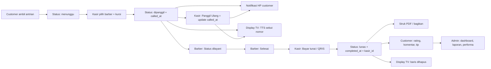

# BarberSys — Sistem Antrian & Kasir Barbershop

BarberSys adalah aplikasi manajemen barbershop berbasis **Expo Router (React Native)** untuk empat peran — **Customer, Kasir, Barber, Admin** — ditambah **Display TV** berbasis React + Vite yang menampilkan antrian publik dan mengumumkan panggilan dalam Bahasa Indonesia.

Dokumen ini menjelaskan arsitektur, alur bisnis, struktur basis data, cara menjalankan aplikasi, pengujian, dan daftar bukti tangkapan layar untuk keperluan tugas RPL.

---

## 1. Ringkasan Sistem

| Peran | Tanggung jawab utama |
|---|---|
| **Customer** | Melihat treatment, mengambil antrian, memantau status, menerima notifikasi giliran, membayar QRIS simulasi, memberi rating & tip, melihat riwayat. |
| **Kasir** | Mengelola antrian masuk, memilih barber & kursi, memanggil customer (bisa **panggil ulang**), memproses pembayaran tunai/QRIS, mencetak/membagikan struk, melihat riwayat transaksi. |
| **Barber** | Melihat tugas yang ditugaskan, menandai layanan selesai, mengatur status istirahat, melihat riwayat, performa/rating, dan tip yang diterima. |
| **Admin** | Mengelola treatment, produk, pegawai; melihat dashboard & laporan; memeriksa rating/komentar; mengatur jam operasional & jumlah kursi. |
| **Display TV** | Menampilkan jam WIB, daftar antrian publik, sorotan panggilan terbaru, ticker, dan pengumuman suara Bahasa Indonesia (Piper lokal). |

### Ruang lingkup

- **Termasuk:** alur antrian → panggil → layani → bayar → display; struk PDF; rating; tip; laporan PDF/XLSX; notifikasi lokal; QRIS simulasi.
- **Tidak termasuk:** payment gateway sungguhan, printer thermal fisik, remote push notification, perubahan skema DB spontan.
- Semua perhitungan tanggal memakai **WIB (UTC+7)**, bukan timezone perangkat.

---

## 2. Teknologi & Struktur Proyek

### Tech stack

| Lapisan | Teknologi |
|---|---|
| Aplikasi mobile/web | Expo SDK 58, Expo Router, React Native 0.88, TypeScript strict |
| Styling | NativeWind + UI kit neo-brutalism editorial (`src/components/ui`) |
| Backend | Supabase (Postgres, Auth, Realtime, Storage, RPC/Edge Functions) |
| PDF & share | `expo-print`, `expo-sharing`, `expo-file-system/legacy` |
| Ekspor laporan | `xlsx` (import statis agar tidak dipecah Metro) |
| Notifikasi & kamera | `expo-notifications`, `expo-camera` |
| Display TV | React + Vite + TypeScript, `@supabase/supabase-js`, `@mintplex-labs/piper-tts-web`, `onnxruntime-web` |
| Testing | Node test runner (`node --experimental-strip-types --test`) |
| Dokumentasi | Markdown + diagram Mermaid |

### Peta folder

```text
BarberSys/
├── docs/                          # PRD, design spec, plan, bukti screenshot
│   ├── prd .md                    # Sumber kebenaran requirement & skema DB
│   ├── design.md                  # Token desain "Editorial Barber"
│   └── screenshots/               # Bukti UI per role (lihat bab 9)
├── BarberSys/                     # Aplikasi Expo
│   ├── src/app/
│   │   ├── (auth)/                # Login & register
│   │   ├── customer/              # Treatment, antrian, status, riwayat, profil
│   │   ├── kasir/                 # Antrian, panggil, pembayaran, riwayat, profil
│   │   ├── barber/                # Tugas, riwayat, performa, tip, profil
│   │   ├── admin/                 # Ringkasan, treatment, produk, pegawai, laporan, profil
│   │   ├── admin-rating.tsx       # Rating & komentar (Stack root, bukan tab)
│   │   ├── scan-qris.tsx          # Pemindai QRIS customer
│   │   └── display.tsx            # Fallback Display TV di Expo
│   ├── src/components/            # UI kit & komponen bersama
│   ├── src/lib/                   # Logika domain murni + integrasi Supabase
│   ├── src/hooks/                 # Role guard & notifikasi antrian
│   ├── scripts/                   # Unit test (.mjs)
│   └── .env.example               # Template kredensial Supabase
└── display-tv/                    # Aplikasi Display TV (React + Vite)
    ├── src/App.tsx
    ├── src/lib/                   # Supabase, use-display, use-speech, TTS engine
    └── src/styles.css
```

---

## 3. Alur Bisnis End-to-End



### 3.1 Customer

1. Login sebagai customer, pilih **Treatment**, isi instruksi potongan (opsional).
2. Ambil antrian → baris `queue` dengan status `menunggu`, `user_id` terisi.
3. Jika di luar jam operasional, antrian ditahan dengan `hold_until` (Fase 4).
4. Pantau **Status**: posisi antrean, barber, kursi, estimasi tunggu.
5. Saat kasir memanggil, notifikasi lokal muncul: *"Giliranmu tiba!"*.
6. Setelah layanan selesai, bayar lewat QRIS simulasi (pindai QR kasir) atau tunai di kasir.
7. Beri **rating 1–5**, komentar, dan tip; lihat riwayat + struk + tip yang pernah diberikan.

### 3.2 Kasir

1. Lihat daftar antrian `menunggu`; bisa membuat **walk-in manual**.
2. Buka layar **Panggil Antrian**, pilih barber (yang tidak istirahat) dan kursi kosong.
3. Konfirmasi → `status = dipanggil`, `called_at = now`.
4. Modal sukses menyediakan **Panggil Ulang** (hanya mengubah `called_at`) dan **Selesai**.
5. Tandai layanan selesai → status `selesai`; terima pembayaran tunai/QRIS → status `lunas`, isi `kasir_id` & `completed_at`.
6. Cetak/bagikan struk; lihat **Riwayat** dengan filter tanggal WIB.

### 3.3 Barber

1. Tab **Tugas**: antrian dengan `barber_id = dirinya`, toggle istirahat, jam operasional.
2. Tandai antrian selesai; sistem menghitung status Sibuk/Tersedia secara on-the-fly.
3. Tab **Riwayat**: transaksi lunas miliknya + cetak struk.
4. Tab **Performa**: rating, komentar, statistik harian/mingguan.
5. Tab **Tip**: rekap tip 30 hari, filter 7/30/semua, daftar pemberi tip.
6. Tab **Profil**: edit profil + kartu pengaturan toko (info-only).

### 3.4 Admin

1. **Ringkasan**: omset hari ini, tiket, kepuasan, barber aktif, grafik omset 7 hari, performa barber, rating terbaru, antrian live, transaksi terbaru, pintasan.
2. **Treatment / Produk / Pegawai**: CRUD katalog & akun staff.
3. **Laporan**: filter hari/minggu/bulan, ekspor PDF & XLSX.
4. **Rating & Komentar**: filter barber, periode, nilai minimal; distribusi bintang.
5. **Profil**: pengaturan akun & tampilan.

### 3.5 Display TV

- Mengambil proyeksi publik `queue_display` via Supabase Realtime + polling fallback 30 detik.
- Menampilkan jam WIB, daftar antrian, sorotan panggilan terbaru, ticker.
- Tombol **Aktifkan Suara** memuat model Piper `id_ID-news_tts-medium` (unduh sekali, disimpan di OPFS browser), lalu mengumumkan nomor dalam Bahasa Indonesia.
- Dedupe pengumuman per `queue_id + called_at`; tombol **Tes Suara** dan pilihan mesin **Piper Indonesia (lokal)** / **Suara Browser**.

---

## 4. Basis Data

Sumber kebenaran: `docs/prd .md` §7 dan `BarberSys/src/types/database.ts`. Tidak ada file migrasi SQL yang disimpan di repo; skema berada langsung di project Supabase.

### 4.1 Entity Relationship Diagram (Mermaid)

```mermaid
erDiagram
    PROFILES ||--o{ QUEUE : "user_id (customer)"
    PROFILES ||--o{ QUEUE : "barber_id"
    PROFILES ||--o{ QUEUE : "kasir_id"
    TREATMENTS ||--o{ QUEUE : "treatment_id"
    QUEUE ||--o{ QUEUE_PRODUCTS : "queue_id"
    PRODUCTS ||--o{ QUEUE_PRODUCTS : "product_id"
    QUEUE ||--o| QUEUE_DISPLAY : "queue_id (proyeksi publik)"

    PROFILES {
        uuid id PK
        text nama
        text email
        text no_hp
        text role "customer|barber|kasir|admin"
        text status_akun "aktif|nonaktif"
        text status_kerja "aktif|istirahat|null"
        text foto_url
        timestamptz created_at
    }
    TREATMENTS {
        uuid id PK
        text nama
        integer harga
        integer durasi_menit
        text deskripsi
        text foto_url
        boolean aktif
    }
    PRODUCTS {
        uuid id PK
        text nama
        integer harga
        text kategori
        text foto_url
        boolean aktif
    }
    QUEUE {
        uuid id PK
        integer nomor_antrian
        uuid user_id FK
        text nama_customer "walk-in"
        uuid barber_id FK
        uuid kasir_id FK
        uuid treatment_id FK
        smallint kursi_nomor
        timestamptz hold_until
        text status "menunggu|dipanggil|dilayani|selesai|lunas|dibatalkan"
        text instruksi_potongan
        integer rating "1-5"
        text komentar
        integer tip_amount
        text metode_bayar "tunai|qris"
        timestamptz created_at
        timestamptz called_at
        timestamptz completed_at
    }
    QUEUE_PRODUCTS {
        uuid id PK
        uuid queue_id FK
        uuid product_id FK
        integer qty
        integer subtotal
    }
    QUEUE_DISPLAY {
        uuid queue_id PK_FK
        integer nomor_antrian
        text status "menunggu|dipanggil|dilayani"
        timestamptz hold_until
        text barber_nama
        smallint kursi_nomor
        timestamptz created_at
        timestamptz called_at
        timestamptz updated_at
    }
    BARBERSHOP_SETTINGS {
        uuid id PK
        text nama_toko
        text alamat
        time jam_buka
        time jam_tutup
        integer jumlah_kursi
    }
```

### 4.2 Deskripsi tabel

#### `profiles` — seluruh pengguna

| Kolom | Tipe | Keterangan |
|---|---|---|
| `id` | uuid (PK) | Sama dengan `auth.users.id` |
| `nama` | text | Nama lengkap |
| `email` | text | Email login |
| `no_hp` | text | Nomor telepon |
| `role` | text | `customer` / `barber` / `kasir` / `admin` |
| `status_akun` | text | `aktif` / `nonaktif` |
| `status_kerja` | text | `aktif` / `istirahat` (barber) |
| `foto_url` | text | URL foto di bucket `avatars` |
| `created_at` | timestamptz | Waktu dibuat |

#### `treatments` — katalog layanan

| Kolom | Tipe | Keterangan |
|---|---|---|
| `id` | uuid (PK) | |
| `nama` | text | Nama treatment |
| `harga` | integer | Harga Rupiah |
| `durasi_menit` | integer | Estimasi durasi |
| `deskripsi` | text | Deskripsi singkat |
| `foto_url` | text | URL bucket `treatments` |
| `aktif` | boolean | Soft-delete |

#### `products` — katalog produk retail

| Kolom | Tipe | Keterangan |
|---|---|---|
| `id` | uuid (PK) | |
| `nama` | text | Nama produk |
| `harga` | integer | Harga |
| `kategori` | text | Mis. pomade / powder / haircare |
| `foto_url` | text | URL bucket `products` |
| `aktif` | boolean | Soft-delete |

#### `queue` — tabel inti transaksi

| Kolom | Tipe | Keterangan |
|---|---|---|
| `id` | uuid (PK) | |
| `nomor_antrian` | integer | Nomor urut harian |
| `user_id` | uuid (FK → profiles) | Customer; NULL untuk walk-in |
| `nama_customer` | text | Nama walk-in |
| `barber_id` | uuid (FK → profiles) | Barber tujuan |
| `kasir_id` | uuid (FK → profiles) | Kasir yang memproses |
| `treatment_id` | uuid (FK → treatments) | Layanan dipilih |
| `kursi_nomor` | smallint | 1…`jumlah_kursi`; NULL sebelum dipanggil |
| `hold_until` | timestamptz | Penahanan di luar jam buka (WIB) |
| `status` | text | `menunggu`, `dipanggil`, `dilayani`, `selesai`, `lunas`, `dibatalkan` |
| `instruksi_potongan` | text | Permintaan khusus customer |
| `rating` | integer | 1–5, nullable |
| `komentar` | text | Ulasan opsional |
| `tip_amount` | integer | Tip (Rupiah), default 0 |
| `metode_bayar` | text | `tunai` / `qris` |
| `created_at` | timestamptz | Waktu ambil antrian |
| `called_at` | timestamptz | Waktu dipanggil (**dedupe notif & TTS**) |
| `completed_at` | timestamptz | Waktu lunas (**tanggal struk**) |

#### `queue_products` — item produk per transaksi

| Kolom | Tipe | Keterangan |
|---|---|---|
| `id` | uuid (PK) | |
| `queue_id` | uuid (FK → queue) | Transaksi induk |
| `product_id` | uuid (FK → products) | Produk |
| `qty` | integer | Jumlah |
| `subtotal` | integer | `harga × qty` saat insert |

#### `queue_display` — proyeksi publik untuk Display TV

Hanya kolom aman; **tanpa** nama customer, HP, `user_id`, treatment, tip, atau metode bayar.

| Kolom | Tipe | Keterangan |
|---|---|---|
| `queue_id` | uuid (PK, FK → queue) | Satu baris per antrian aktif |
| `nomor_antrian` | integer | Nomor antrian |
| `status` | text | Hanya `menunggu` / `dipanggil` / `dilayani` |
| `hold_until` | timestamptz | Antrian ditahan tidak ditampilkan |
| `barber_nama` | text | Nama barber tujuan |
| `kursi_nomor` | smallint | Kursi tujuan |
| `created_at` | timestamptz | Urutan antrian |
| `called_at` | timestamptz | Dasar pengumuman suara |
| `updated_at` | timestamptz | Sinkron terakhir |

#### `barbershop_settings` — konfigurasi toko (1 baris)

| Kolom | Tipe | Keterangan |
|---|---|---|
| `id` | uuid (PK) | |
| `nama_toko` | text | Nama toko |
| `alamat` | text | Alamat |
| `jam_buka` | time | Jam buka |
| `jam_tutup` | time | Jam tutup |
| `jumlah_kursi` | integer | Jumlah kursi aktif |

### 4.3 Row Level Security (ringkasan)

| Tabel | Aturan |
|---|---|
| `profiles` | User hanya baca/ubah miliknya; Admin bisa semua |
| `treatments`, `products` | Semua role terautentikasi bisa `SELECT`; hanya Admin yang menulis |
| `queue` | Customer hanya baris miliknya; Barber hanya baris dengan `barber_id = dirinya`; Kasir & Admin semua |
| `queue_products` | Mengikuti hak `queue` induk |
| `queue_display` | `anon`/`authenticated` hanya `SELECT`; tulis hanya via trigger `SECURITY DEFINER` |
| `barbershop_settings` | Semua bisa baca; hanya Admin ubah |

### 4.4 RPC, trigger & Storage

| Objek | Fungsi |
|---|---|
| `queue_my_status()` | RPC `SECURITY DEFINER` untuk status antrian customer + posisi antrean (menghindari RLS lintas user) |
| `queue_load_stats()` | RPC agregat estimasi tunggu per barber/global |
| `barber_rating_stats()` | RPC agregat rating per barber untuk dashboard |
| `queue_guard_insert` / `queue_guard_update` | Trigger validasi transisi status & larangan customer memalsukan `status`, `tip_amount`, `kursi_nomor`, `hold_until` |
| Sinkron `queue_display` | Trigger `SECURITY DEFINER` menjaga proyeksi publik tetap selaras dengan `queue` |
| Bucket `avatars` | Foto profil; publik baca, user tulis folder sendiri |
| Bucket `treatments` | Foto layanan; publik baca, Admin tulis |
| Bucket `products` | Foto produk; publik baca, Admin tulis |

---

## 5. Menjalankan Aplikasi

### 5.1 Prasyarat

- Node.js 22 LTS, npm, Expo Go di HP Android/iOS.
- Project Supabase dengan skema & RLS sesuai bab 4.
- File `BarberSys/.env`:

```dotenv
EXPO_PUBLIC_SUPABASE_URL=https://<project>.supabase.co
EXPO_PUBLIC_SUPABASE_ANON_KEY=<publishable-anon-key>
```

- File `display-tv/.env` (salin dari `.env.example`):

```dotenv
VITE_SUPABASE_URL=https://<project>.supabase.co
VITE_SUPABASE_ANON_KEY=<publishable-anon-key>
```

> Jangan menaruh `service_role` key di aplikasi klien.

### 5.2 Perintah

```bash
# Aplikasi Expo (Metro)
cd BarberSys
npm install
npm run start                 # atau: npx expo start --go --lan --port 8081

# Display TV
cd display-tv
npm install
npm run dev                   # http://localhost:5173
npm run build                 # build produksi Vite
```

Buka Expo di HP melalui `exp://<ip-lan>:8081`, atau jalankan `npx expo start --web --port 8081` untuk tampilan browser (dipakai untuk screenshot dokumentasi).

### 5.3 Akun uji

| Role | Email | Password |
|---|---|---|
| Admin | `admin@barbersys.com` | `Password123!` |
| Kasir | `kasir@barbersys.com` | `Password123!` |
| Barber | `barber@barbersys.com` | `Password123!` |
| Customer | `customer@barbersys.com` | `Password123!` |

Detail: `docs/akun-demo.md`. Register hanya untuk customer; staff dibuat Admin lewat menu **Pegawai**.

---

## 6. Pengujian

```bash
cd BarberSys
npm run test:unit     # node --experimental-strip-types --test scripts/*.mjs
npm run typecheck     # tsc --noEmit
cd display-tv && npm run build
```

Unit test mencakup helper murni: waktu WIB, antrean & kursi, estimasi, QRIS, struk & pembayaran, share PDF, riwayat & tip, rating, dashboard, performa barber, notifikasi, pengumuman/TTS, kamera, navigasi, dan panggil ulang.

Pada kondisi terakhir: **139 test lulus**. `typecheck` masih menyisakan error pada file template bawaan Expo (`app-tabs*`, `hint-row`, `themed-view`, `use-theme`) yang tidak dipakai fitur aplikasi.

### Checklist manual (Expo Go / browser)

- [ ] Admin Laporan → PDF & XLSX berhasil dibagikan (tidak ada `unknown module 2333` / `Not allowed to read file`).
- [ ] Kasir bayar tunai & QRIS → Riwayat → cetak ulang struk (tanggal `completed_at`, kasir asli).
- [ ] Kasir panggil → **Panggil Ulang** → HP customer notif lagi & TV bicara lagi.
- [ ] Barber melihat hanya antriannya; tab Performa & Tip berfungsi.
- [ ] Customer Riwayat menampilkan tip per barber.
- [ ] Display TV: Aktifkan Suara (unduh model sekali) → Tes Suara terdengar Bahasa Indonesia.

---

## 7. Status Fitur

| Fase | Isi | Status |
|---|---|---|
| 0–3 | Auth, antrian, rating, katalog, produk, instruksi, struk PDF, walk-in | Selesai |
| 4 | Tip, jam operasional, estimasi, laporan PDF/XLSX, dashboard | Selesai |
| 5 | Display TV + TTS + notifikasi lokal | Selesai |
| 6 | QRIS dummy (kamera + QR) | Selesai |
| UI 2.0 | Redesign "Editorial Barber" + UI kit + toggle tema | Selesai |
| 7A | Riwayat & struk kasir/barber + fix share PDF/XLSX | Selesai |
| 7B | Rating & komentar admin | Selesai |
| 7C | Dashboard admin diperkaya | Selesai |
| 7D | Menu barber 4 tab + pengaturan | Selesai |
| 7E | Display TV React + Vite | Selesai |
| 7F | Tip barber/customer, fix kamera & rating | Selesai |
| 7G | TTS Piper Bahasa Indonesia lokal | Selesai |
| 7H | Panggil ulang dari kasir | Selesai |
| 7I | README + screenshot dokumentasi | Selesai |

---

## 8. Batasan & Catatan

- QRIS adalah **simulasi**: tidak ada transaksi finansial nyata.
- TTS Piper mengunduh model ±63 MB sekali per browser; WASM diambil dari jsDelivr, sehingga koneksi internet diperlukan saat first load.
- `expo-sharing` di Expo Go hanya menerima URI di cache experience; helper `share-pdf.ts` menulis ulang PDF ke `FileSystem.cacheDirectory`.
- `xlsx` harus di-import statis (import dinamis gagal di Metro/Hermes).
- Display TV Expo `/display` dipertahankan sebagai fallback; versi produksi adalah `display-tv/`.
- Commit/merge/push dilakukan hanya atas perintah eksplisit.

---

## 9. Bukti Tangkapan Layar

Semua screenshot disimpan di folder `docs/screenshots/` (tidak di-embed di README ini). Screenshot mobile diambil dari Expo Router dev server dengan emulasi **iPhone 15 Pro** (393×852, DPR 3, user-agent iPhone); Display TV diambil pada viewport 16:9.

| Grup | File |
|---|---|
| Auth | `01-login.png` |
| Customer | `customer-01-treatment.png`, `customer-02-queue-new.png`, `customer-03-status.png`, `customer-04-history.png`, `customer-05-profile.png` |
| Kasir | `kasir-01-antrian.png`, `kasir-02-panggil.png`, `kasir-03-panggil-ulang.png`, `kasir-04-pembayaran.png`, `kasir-05-riwayat.png`, `kasir-06-profile.png` |
| Barber | `barber-01-tugas.png`, `barber-02-riwayat.png`, `barber-03-performa.png`, `barber-04-tip.png`, `barber-05-profile.png` |
| Admin | `admin-01-ringkasan.png`, `admin-02-rating.png`, `admin-03-treatment.png`, `admin-04-produk.png`, `admin-05-pegawai.png`, `admin-06-laporan.png`, `admin-07-profile.png` |
| Display TV | `display-tv.png` |

---

## 10. Referensi

- `docs/prd .md` — requirement, ERD, RLS, aturan kerja.
- `docs/design.md` — sistem desain Neo-Brutalism Editorial.
- `docs/superpowers/specs/2026-11-24-riwayat-struk-rating-display-design.md` — spec lanjutan Fase 7.
- `docs/superpowers/plans/` — rencana implementasi per fase.
- `docs/superpowers/plans/2026-11-24-fase7-progress.md` — ledger progres Fase 7.
