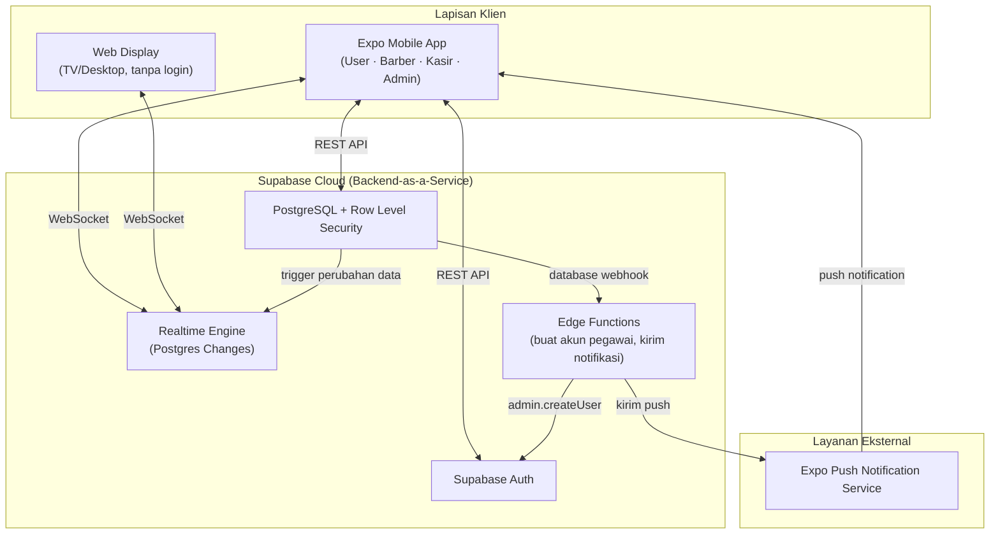
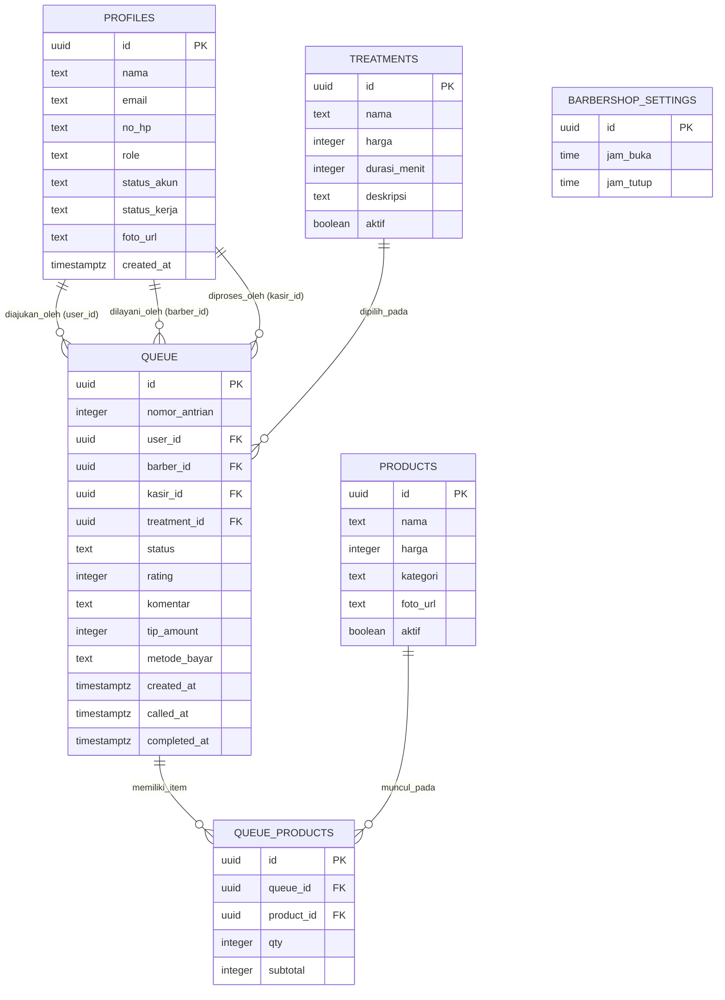
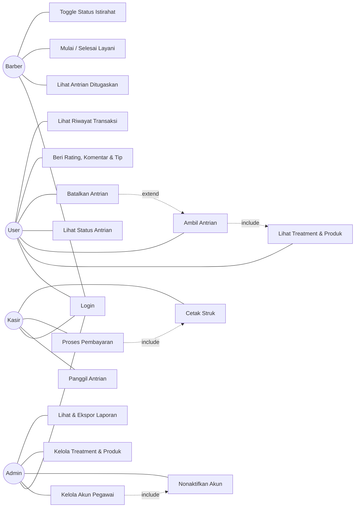
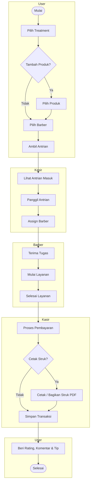
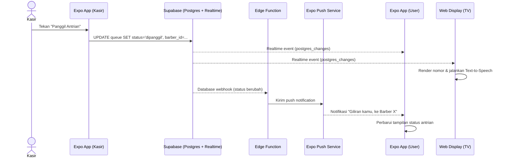
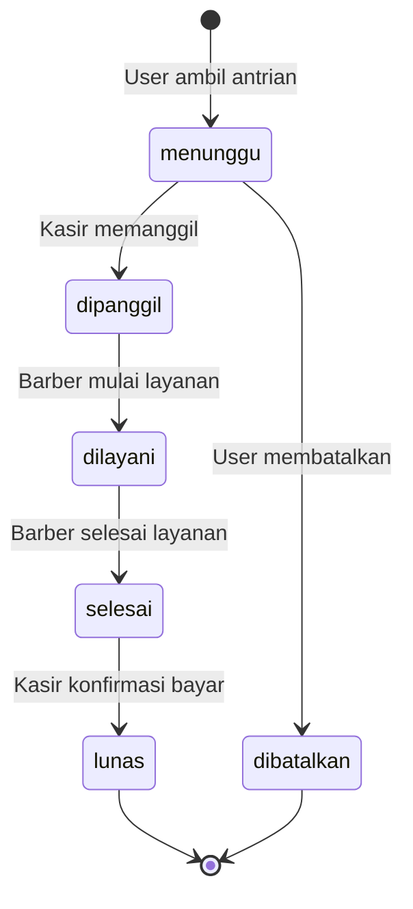
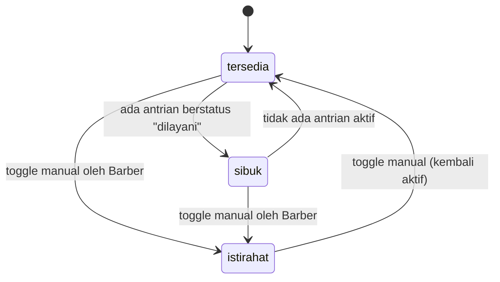
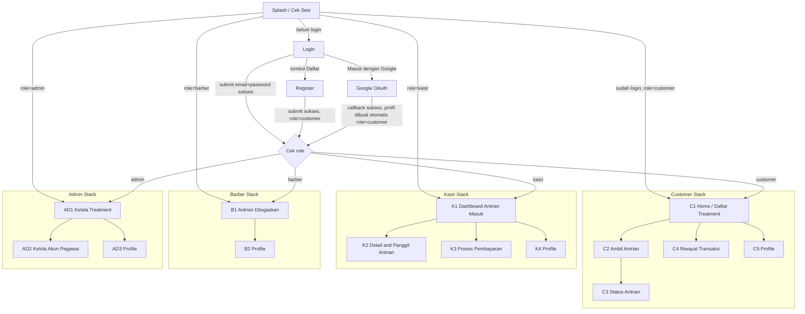

# BarberSys — Product Requirements Document (PRD)

**Sistem Informasi Manajemen Antrian & Layanan Barbershop**

## 0. Identitas Proyek & Aplikasi

| Atribut | Keterangan |
|---|---|
| **Nama Aplikasi** | **BarberSys** |
| **Tagline** | "Antre tanpa nunggu, layanan tanpa ribet." |
| **Kategori** | Aplikasi mobile manajemen antrian & layanan barbershop (multi-role) |
| **Mata Kuliah** | Rekayasa Perangkat Lunak (RPL) — Tugas 1: Proyek Perangkat Lunak |
| **Target Pengguna** | Pelanggan barbershop, barber, kasir, dan pemilik/admin barbershop skala kecil-menengah |
| **Platform** | Mobile (Expo / React Native — Android & iOS) + Web Display (TV/Desktop) |
| **Backend** | Supabase (PostgreSQL, Auth, Realtime, Edge Functions) |
| **Versi Dokumen** | 2.0 |
| **Terakhir diperbarui** | 14 September 2026 |

### Daftar Isi
1. Ringkasan Eksekutif
2. Latar Belakang & Rumusan Masalah
3. Tujuan Sistem
4. Ruang Lingkup
5. Aktor & Role Pengguna
6. Arsitektur Sistem
7. Rancangan Basis Data
8. Use Case Diagram & Deskripsi
9. Activity Diagram
10. Sequence Diagram
11. State Diagram
12. Roadmap Fase Pengembangan
13. Functional Requirements per Fase
14. Non-Functional Requirements
15. Kebijakan & Aturan Bisnis
16. Metrik Keberhasilan Proyek
17. Risiko & Mitigasi
18. Lampiran — Daftar Istilah
19. Aturan Kerja untuk AI/Agent Pengembang
20. Backlog Perbaikan & Planning Tambahan

---

## 1. Ringkasan Eksekutif

**BarberSys** adalah sistem informasi manajemen antrian dan layanan barbershop berbasis mobile yang menggantikan proses antrian manual (datang-lalu-tunggu) dengan alur digital real-time. Sistem menghubungkan empat peran — **User (Customer)**, **Barber**, **Kasir**, dan **Admin** — dalam satu aplikasi Expo yang sama, ditambah satu layar tampilan publik (**Display Antrian**) yang dipasang di TV/desktop toko dan dilengkapi pengumuman suara otomatis (Text-to-Speech).

Proyek ini dikerjakan bertahap selama satu semester mengikuti siklus SDLC (perencanaan → analisis → desain → implementasi → pengujian → evaluasi), sesuai ketentuan Tugas 1 mata kuliah RPL.

---

## 2. Latar Belakang & Rumusan Masalah

### 2.1 Latar Belakang

Sebagian besar barbershop skala kecil-menengah masih mengandalkan sistem antrian manual: pelanggan datang langsung, menulis/menyebut nama ke kasir, lalu menunggu tanpa kepastian waktu. Informasi harga treatment, ketersediaan barber, dan riwayat kunjungan juga umumnya tidak tercatat secara digital.

### 2.2 Rumusan Masalah

1. Pelanggan harus menunggu secara fisik di tempat tanpa kepastian waktu giliran, sehingga waktu mereka terbuang.
2. Pelanggan tidak memiliki akses ke informasi harga treatment dan ketersediaan barber sebelum datang.
3. Pelanggan tidak dapat memilih barber sesuai preferensi karena tidak ada data profil/rating barber.
4. Tidak ada catatan riwayat transaksi/treatment yang bisa diakses pelanggan.
5. Alur kerja internal (kasir, barber, admin) tidak sinkron — sulit melacak siapa sudah dilayani, siapa belum membayar, siapa sedang sibuk.
6. Tidak ada mekanisme apresiasi kinerja barber (rating, tip) yang tercatat secara sistematis.

---

## 3. Tujuan Sistem

1. Memungkinkan pelanggan mengambil antrian dan memilih treatment/barber dari jarak jauh, tanpa menunggu fisik di tempat.
2. Menyediakan informasi treatment, harga, durasi, dan produk secara transparan sebelum pelanggan datang.
3. Memberikan estimasi waktu tunggu dan status antrian secara real-time.
4. Menyatukan alur kerja Kasir, Barber, dan Admin dalam satu sumber data yang konsisten.
5. Menyediakan mekanisme rating, komentar, dan tip sebagai bentuk apresiasi terhadap kinerja barber.
6. Menyediakan laporan transaksi yang dapat diekspor untuk kebutuhan evaluasi bisnis.

---

## 4. Ruang Lingkup

### 4.1 Termasuk dalam Scope

- Aplikasi mobile (Expo) untuk 4 role: User, Barber, Kasir, Admin, dalam satu codebase dengan navigasi berbasis role.
- Manajemen antrian real-time berbasis Supabase Realtime.
- Manajemen treatment, produk, dan harga.
- Alur pembayaran (dicatat di sistem, transaksi uang fisik tetap di kasir — bukan payment gateway).
- Rating, komentar, dan tip untuk barber.
- Layar Display Antrian (web, publik, tanpa login) dengan pengumuman suara (Text-to-Speech).
- Laporan transaksi dan ekspor (PDF/Excel).
- Cetak/bagikan struk digital (PDF via `expo-print`).

### 4.2 Di Luar Scope (Out of Scope)

- Payment gateway sungguhan (Midtrans/Xendit/QRIS API) — pembayaran hanya dicatat statusnya di sistem.
- Manajemen stok produk (tracking kuantitas inventori).
- Sistem multi-cabang/multi-tenant.
- Cetak struk ke printer thermal Bluetooth fisik (digantikan cetak PDF).
- Aplikasi terpisah per role (semua role berada dalam satu aplikasi Expo yang sama).
- Fitur reservasi jadwal di jam tertentu (sistem ini murni antrian real-time, bukan booking berbasis slot waktu).

---

## 5. Aktor & Role Pengguna

| Role | Deskripsi | Cara Dapat Akun |
|---|---|---|
| **User (Customer)** | Pelanggan yang memesan treatment dan mengambil antrian | Registrasi mandiri di aplikasi |
| **Barber** | Pegawai yang melayani treatment | Dibuatkan oleh Admin |
| **Kasir** | Mengelola pemanggilan antrian dan pembayaran | Dibuatkan oleh Admin |
| **Admin** | Pemilik/manajer; mengelola akun, treatment, produk, dan laporan | Akun pertama disiapkan saat setup sistem |

Barber dan Kasir **tidak bisa mendaftar mandiri** — akun mereka dibuat dan dinonaktifkan oleh Admin, mencerminkan hubungan kerja pegawai-pemilik di dunia nyata.

---

## 6. Arsitektur Sistem

### 6.1 Gambaran Umum

BarberSys menggunakan arsitektur **client-heavy, Backend-as-a-Service (BaaS)** — tidak ada server backend custom yang ditulis sendiri. Seluruh logika data, autentikasi, dan sinkronisasi real-time ditangani Supabase, sementara Expo App dan Web Display bertindak sebagai klien yang terhubung langsung ke Supabase lewat REST API dan WebSocket.

### 6.2 Diagram Arsitektur



### 6.3 Komponen Arsitektur

| Komponen | Peran |
|---|---|
| **Expo Mobile App** | Satu aplikasi untuk 4 role; navigasi diarahkan sesuai `role` di tabel `profiles` setelah login |
| **Web Display** | Halaman statis (HTML/JS atau Expo Web export), read-only, tanpa autentikasi, dipasang di layar TV toko |
| **Supabase Auth** | Menangani registrasi, login (email/password, serta Google OAuth khusus role Customer), sesi, dan reset password |
| **PostgreSQL + RLS** | Sumber data tunggal; Row Level Security memastikan setiap role hanya bisa mengakses data sesuai haknya di level database, bukan hanya di sisi tampilan |
| **Realtime Engine** | Mendorong perubahan tabel `queue` ke seluruh klien yang subscribe, tanpa perlu polling manual |
| **Edge Functions** | Kode server-side ringan untuk operasi yang butuh hak akses tinggi (Service Role Key), seperti membuat akun pegawai dan memicu push notification |
| **Expo Push Service** | Layanan eksternal Expo untuk mengirim notifikasi push ke perangkat User |

### 6.4 Alasan Pemilihan Stack

- **Expo** dipilih karena tidak butuh setup native project terpisah untuk Android/iOS, mendukung push notification dan cetak PDF bawaan, dan cukup di-demo lewat Expo Go tanpa proses build.
- **Supabase** dipilih karena menyediakan database, autentikasi, dan realtime dalam satu layanan terkelola (hosted), sehingga kelompok tidak perlu membangun dan meng-hosting backend sendiri.
- **Row Level Security (RLS)** menjadi lapisan keamanan utama — bukan hanya validasi role di sisi UI — agar setiap role hanya bisa mengakses data yang menjadi haknya, walau request API dipanggil langsung tanpa lewat aplikasi.

---

## 7. Rancangan Basis Data

### 7.1 Entity Relationship Diagram (ERD)



### 7.2 Deskripsi Tabel

**`profiles`** — data seluruh pengguna (diperluas dari `auth.users` bawaan Supabase)

| Kolom | Tipe | Keterangan |
|---|---|---|
| id | uuid (PK) | Sama dengan id di `auth.users` |
| nama | text | Nama lengkap |
| email | text | Email login |
| no_hp | text | Nomor telepon |
| role | text | `customer` / `barber` / `kasir` / `admin` |
| status_akun | text | `aktif` / `nonaktif` — dipakai Admin untuk menonaktifkan pegawai |
| status_kerja | text | `aktif` / `istirahat` — khusus role barber, di-toggle manual |
| foto_url | text | Tautan foto profil |
| created_at | timestamptz | Waktu akun dibuat |

**`treatments`** — katalog layanan

| Kolom | Tipe | Keterangan |
|---|---|---|
| id | uuid (PK) | |
| nama | text | Nama treatment |
| harga | integer | Harga tetap (Rupiah) |
| durasi_menit | integer | Estimasi durasi pengerjaan |
| deskripsi | text | Deskripsi singkat |
| aktif | boolean | Untuk soft-delete tanpa hapus data historis |

**`products`** — katalog produk retail (pomade, powder, dll)

| Kolom | Tipe | Keterangan |
|---|---|---|
| id | uuid (PK) | |
| nama | text | Nama produk |
| harga | integer | Harga tetap |
| kategori | text | Mis. pomade / powder / haircare |
| foto_url | text | Foto produk |
| aktif | boolean | Soft-delete |

**`queue`** — tabel inti transaksi antrian

| Kolom | Tipe | Keterangan |
|---|---|---|
| id | uuid (PK) | |
| nomor_antrian | integer | Nomor urut harian |
| user_id | uuid (FK → profiles) | Pelanggan yang mengambil antrian |
| barber_id | uuid (FK → profiles) | Barber yang ditugaskan |
| kasir_id | uuid (FK → profiles) | Kasir yang memproses |
| treatment_id | uuid (FK → treatments) | Treatment yang dipilih |
| status | text | `menunggu` / `dipanggil` / `dilayani` / `selesai` / `lunas` / `dibatalkan` |
| rating | integer | 1–5, nullable sampai User memberi rating |
| komentar | text | Opsional |
| tip_amount | integer | Nominal tip, default 0 |
| metode_bayar | text | `tunai` / `qris` (dicatat saja, bukan transaksi elektronik nyata) |
| created_at | timestamptz | Waktu antrian diambil |
| called_at | timestamptz | Waktu dipanggil Kasir |
| completed_at | timestamptz | Waktu status menjadi lunas |

**`queue_products`** — tabel penghubung produk yang dibeli dalam satu transaksi (relasi many-to-many antara `queue` dan `products`)

| Kolom | Tipe | Keterangan |
|---|---|---|
| id | uuid (PK) | |
| queue_id | uuid (FK → queue) | |
| product_id | uuid (FK → products) | |
| qty | integer | Jumlah dibeli |
| subtotal | integer | harga produk × qty (dihitung saat insert, bukan formula tersimpan) |

**`barbershop_settings`** — konfigurasi umum (1 baris data)

| Kolom | Tipe | Keterangan |
|---|---|---|
| id | uuid (PK) | |
| jam_buka | time | Jam mulai operasional |
| jam_tutup | time | Jam tutup operasional |

### 7.3 Ringkasan Kebijakan Row Level Security (RLS)

| Tabel | Aturan Akses Ringkas |
|---|---|
| `profiles` | User hanya bisa membaca/mengubah baris miliknya sendiri; Admin bisa membaca/mengubah semua baris |
| `treatments`, `products` | Semua role terautentikasi bisa membaca (`SELECT`); hanya Admin yang bisa `INSERT`/`UPDATE`/`DELETE` |
| `queue` | User hanya bisa melihat & membuat baris miliknya sendiri; Barber hanya bisa melihat/mengubah baris yang `barber_id`-nya sama dengan dirinya; Kasir & Admin bisa melihat/mengubah semua baris |
| `queue_products` | Mengikuti hak akses baris `queue` induknya |
| `barbershop_settings` | Semua role bisa membaca; hanya Admin bisa mengubah |

---

## 8. Use Case Diagram & Deskripsi

### 8.1 Diagram



> Catatan: Barber, Kasir, dan Admin adalah generalisasi dari aktor **Staff Internal** — ketiganya berbagi use case `Login` yang sama, namun punya akun yang hanya bisa dibuat oleh Admin (bukan mendaftar mandiri seperti User).

### 8.2 Deskripsi Use Case Utama

**UC-00 — Login / Register**
- **Aktor**: User, Barber, Kasir, Admin
- **Deskripsi**: Pengguna masuk ke sistem. Customer dapat mendaftar mandiri (email/password atau Google OAuth); Barber, Kasir, dan Admin login dengan akun yang sudah dibuatkan Admin sebelumnya.
- **Precondition**: Pengguna memiliki akun (untuk Barber/Kasir/Admin) atau belum punya akun sama sekali (khusus Customer, boleh daftar di tempat).
- **Alur Utama (Customer, jalur Google)**:
  1. User menekan "Masuk dengan Google" di layar Login.
  2. Sistem membuka sesi OAuth Google via Supabase Auth.
  3. User menyetujui akses di Google.
  4. Sistem menerima sesi login dari Supabase, mengecek apakah profil sudah ada.
  5. Jika belum ada, sistem otomatis membuat baris `profiles` baru dengan `role = 'customer'`.
  6. Sistem mengarahkan user ke Customer Stack.
- **Alur Alternatif (semua role, email/password)**: user mengisi email & password → sistem validasi via Supabase Auth → sistem membaca `role` dari `profiles` → arahkan ke stack sesuai role.
- **Postcondition**: Sesi aktif tersimpan; pengguna berada di stack yang sesuai rolenya.
- **Catatan penting**: opsi Google OAuth **hanya berlaku untuk role Customer**. Tidak ada jalur bagi Barber/Kasir/Admin untuk membuat akun sendiri lewat Google maupun form Register — akun mereka wajib dibuat Admin (lihat UC-04).

**UC-01 — Ambil Antrian**
- **Aktor**: User
- **Deskripsi**: User memilih treatment, opsional produk dan barber, lalu sistem menghasilkan nomor antrian.
- **Precondition**: User sudah login; berada dalam jam operasional toko.
- **Alur Utama**:
  1. User membuka menu Ambil Antrian.
  2. Sistem menampilkan daftar Treatment (include UC_Treatment).
  3. User memilih Treatment, lalu opsional memilih Produk dan Barber.
  4. Sistem menghitung estimasi waktu tunggu.
  5. User menekan "Ambil Antrian".
  6. Sistem menyimpan baris baru di tabel `queue` dengan status `menunggu`.
- **Postcondition**: Nomor antrian baru tersimpan dan tampil real-time di semua layar terkait.

**UC-02 — Panggil Antrian**
- **Aktor**: Kasir
- **Deskripsi**: Kasir memanggil antrian teratas dan menugaskannya ke seorang barber.
- **Precondition**: Kasir sudah login; ada antrian berstatus `menunggu`.
- **Alur Utama**:
  1. Kasir melihat daftar antrian masuk secara real-time.
  2. Kasir menekan "Panggil" pada nomor teratas.
  3. Kasir mengonfirmasi/memilih barber tujuan.
  4. Sistem mengubah status menjadi `dipanggil` dan mencatat `called_at`.
  5. Sistem memicu pembaruan real-time ke Display TV dan notifikasi ke User.
- **Postcondition**: Status antrian berubah menjadi `dipanggil`; User dan layar TV menerima pembaruan.

**UC-03 — Proses Pembayaran**
- **Aktor**: Kasir
- **Deskripsi**: Kasir menyelesaikan transaksi setelah layanan selesai, termasuk mencetak struk.
- **Precondition**: Status antrian adalah `selesai` (menunggu bayar).
- **Alur Utama**:
  1. Kasir membuka daftar antrian berstatus `selesai`.
  2. Sistem menampilkan rincian treatment dan produk yang dipesan.
  3. Kasir memilih metode bayar dan mencatat tip (jika ada).
  4. Kasir menekan "Konfirmasi Bayar".
  5. Sistem mengubah status menjadi `lunas` (include UC_Struk untuk mencetak/membagikan struk).
- **Postcondition**: Transaksi tercatat lunas dan masuk ke riwayat User serta laporan Admin.

**UC-04 — Kelola Akun Pegawai**
- **Aktor**: Admin
- **Deskripsi**: Admin membuat, mengubah, atau menonaktifkan akun Barber/Kasir.
- **Precondition**: Admin sudah login.
- **Alur Utama**:
  1. Admin membuka menu Kelola Akun.
  2. Admin memilih Tambah Akun, mengisi data pegawai, dan menetapkan role.
  3. Sistem memanggil Edge Function untuk membuat akun tanpa mengganggu sesi Admin.
  4. Untuk menonaktifkan, Admin memilih akun lalu menekan "Nonaktifkan" (include UC_Nonaktif).
- **Postcondition**: Akun pegawai baru aktif, atau akun lama berstatus `nonaktif` dan tidak bisa login.

---

## 9. Activity Diagram — Alur Proses Utama



---

## 10. Sequence Diagram — Panggil Antrian & Notifikasi Real-time



---

## 11. State Diagram

### 11.1 Siklus Status Antrian (`queue.status`)



### 11.2 Status Kerja Barber (`profiles.status_kerja` + turunan otomatis)



> "Tersedia" dan "Sibuk" **tidak disimpan sebagai nilai statis** — keduanya dihitung on-the-fly dari ada/tidaknya baris `queue` berstatus `dilayani` milik barber tersebut. Hanya "Istirahat" yang tersimpan sebagai nilai manual (`status_kerja`), karena hanya barber sendiri yang tahu kapan dirinya benar-benar tidak tersedia.

---

## 12. Roadmap Fase Pengembangan

Fitur dikerjakan berurutan per fase. Fase 1 adalah **MVP wajib** yang harus berfungsi penuh; Fase 2–5 adalah **fitur plus** yang dikerjakan sesuai waktu yang tersisa, tanpa mengganggu stabilitas MVP.

| Fase | Fokus | Status |
|---|---|---|
| **Fase 0** | Fondasi: setup project, database, auth, role | Wajib |
| **Fase 1** | MVP: alur inti antrian dari ambil sampai riwayat | Wajib |
| **Fase 2** | Rating & Komentar, Produk & Perawatan | Plus (prioritas tinggi) |
| **Fase 3** | Status Barber otomatis, Kebijakan Cancel, Cetak Struk | Plus |
| **Fase 4** | Tip, Jam Operasional, Estimasi Waktu Tunggu, Export Laporan | Plus |
| **Fase 5** | Display TV + TTS, Push Notification | Plus (stretch) |

---

## 13. Functional Requirements per Fase

### FASE 0 — Fondasi
- F0.1 Setup project Expo + koneksi Supabase.
- F0.2 Skema database awal: `profiles`, `treatments`, `queue`.
- F0.3 Autentikasi: Login (email/password serta Google OAuth khusus Customer), Register (khusus User/Customer).
- F0.4 Role-based navigation setelah login.
- F0.5 RLS dasar sesuai Bagian 7.3.

### FASE 1 — MVP Inti (Wajib)
**User**
- F1.1 Lihat daftar Treatment beserta harga.
- F1.2 Ambil Antrian: pilih Treatment → pilih Barber → sistem generate nomor antrian.
- F1.3 Lihat Status Antrian secara real-time.
- F1.4 Lihat Riwayat Transaksi.

**Kasir**
- F1.5 Lihat daftar antrian masuk secara real-time.
- F1.6 Panggil Antrian berikutnya, assign ke Barber.
- F1.7 Proses Pembayaran (tandai status `lunas`).

**Barber**
- F1.8 Lihat antrian yang ditugaskan.
- F1.9 Tandai mulai (`dilayani`) dan selesai (`selesai`) layanan.

**Admin**
- F1.10 Kelola Treatment (tambah/edit/hapus, harga, durasi).
- F1.11 Kelola Akun Barber & Kasir (tambah, nonaktifkan).

**Acceptance Criteria Fase 1**: satu siklus penuh (ambil antrian → dipanggil → dilayani → lunas) berjalan tanpa error dan konsisten di seluruh role secara real-time; akun yang dinonaktifkan tidak bisa login.

### 13.1 Spesifikasi Detail Layar — Fase 0 & Fase 1 (Ground Truth untuk AI/Vibe Coding Agent)

> Bagian ini adalah rincian implementasi paling konkret di seluruh dokumen ini, ditulis khusus agar AI coding agent (atau siapa pun yang vibe-coding) **tidak perlu menebak**. Bangun persis sesuai daftar layar dan elemen di bawah. Jangan menambah layar, jangan mengurangi field, jangan mengubah alur navigasi — kecuali sudah dicatat lebih dulu di Backlog (Bagian 20) sesuai Aturan Kerja (Bagian 19). Ini mencakup Fase 0 (modul autentikasi) karena autentikasi adalah prasyarat mutlak sebelum Fase 1 bisa dianggap "selesai".

#### 13.1.1 Peta Navigasi



#### 13.1.2 Modul Autentikasi (Prasyarat Semua Role)

**A0.1 — Splash / Cek Sesi**
- Fungsi: mengecek apakah ada sesi Supabase aktif saat aplikasi dibuka.
- Logika: panggil `supabase.auth.getSession()`. Ada sesi → ambil `role` dari tabel `profiles` berdasarkan `user.id` → arahkan ke stack sesuai role. Tidak ada sesi → arahkan ke Login.
- UI: logo BarberSys + loading indicator, tanpa interaksi apa pun.

**A0.2 — Login**
- Route: `/login`
- Elemen UI: logo/judul aplikasi; input Email (validasi format); input Password (secure entry + toggle show/hide); tombol primary "Masuk" (disabled sampai kedua field terisi); link "Belum punya akun? Daftar" → Register; divider "atau"; tombol "Masuk dengan Google"; link "Lupa Password?" (boleh ditunda ke Fase 4 bila waktu tidak cukup).
- Aksi submit: `supabase.auth.signInWithPassword({ email, password })`. Sukses → cek `role` → redirect ke stack terkait. Gagal → tampilkan pesan error di bawah form ("Email atau password salah"), bukan alert popup generik.
- Aksi Google: lihat 13.1.2.A.
- Loading state: tombol "Masuk" berganti jadi spinner saat proses berjalan, dan disabled agar tidak ter-submit dua kali.

**A0.3 — Register (khusus Customer)**
- Route: `/register`
- Elemen UI: input Nama Lengkap, Email, No. HP, Password, Konfirmasi Password; tombol primary "Daftar"; link "Sudah punya akun? Masuk" → Login.
- Aksi: `supabase.auth.signUp({ email, password })`, lalu insert baris baru ke `profiles` dengan `role: 'customer'`, `status_akun: 'aktif'`.
- Validasi: semua field wajib diisi; email format valid; password minimal 8 karakter; Konfirmasi Password harus sama persis dengan Password; No. HP hanya boleh angka.
- **Catatan penting**: layar ini murni untuk Customer. Tidak ada pilihan role di form — role selalu otomatis `customer`. Barber/Kasir/Admin tidak pernah melewati layar ini (lihat Bagian 5 dan Bagian 19).

**13.1.2.A — Login dengan Google (khusus Customer)**

- **Tujuan**: mempercepat proses daftar/masuk Customer tanpa mengetik password, sekaligus otomatis mengisi nama & foto profil dari akun Google.
- **Provider**: Google OAuth lewat **Supabase Auth** (bukan implementasi OAuth manual dari nol).
- **Library Expo**: `expo-auth-session` + `expo-web-browser` untuk membuka sesi browser OAuth dan menangani redirect kembali ke aplikasi lewat deep link (mis. `barbersys://auth-callback`, sesuai skema yang didaftarkan di konfigurasi Expo/`app.json`).
- **Alur teknis, langkah demi langkah**:
  1. User menekan tombol "Masuk dengan Google" di layar Login (A0.2).
  2. App memanggil `supabase.auth.signInWithOAuth({ provider: 'google', options: { redirectTo: <deep link app> } })`.
  3. Browser terbuka; user memilih akun Google dan menyetujui akses.
  4. Google mengarahkan kembali ke app lewat deep link, membawa kode otorisasi.
  5. Supabase menukar kode tersebut menjadi sesi login (access token + refresh token) dan mengembalikannya ke app.
  6. App mengecek apakah sudah ada baris `profiles` untuk `user.id` tersebut:
     - **Belum ada** → app otomatis membuat baris baru: `role: 'customer'`, `nama` dan `foto_url` diambil dari data profil Google, `status_akun: 'aktif'`.
     - **Sudah ada** → langsung lanjut (berarti user lama login ulang).
  7. App mengarahkan ke Customer Stack (C1 — Home).
- **Aturan pembatasan role — WAJIB dipatuhi**: opsi "Masuk dengan Google" hanya boleh menghasilkan akun berrole `customer`. Ini murni aturan di sisi aplikasi (Google sendiri tidak tahu soal role BarberSys) — Barber, Kasir, dan Admin tetap harus selalu dibuatkan Admin lewat Edge Function (lihat Bagian 6.3 dan UC-04), tidak pernah lewat self-signup dalam bentuk apa pun, termasuk Google.
- **Fallback**: Customer yang tidak punya atau tidak ingin memakai akun Google tetap bisa mendaftar manual lewat A0.3 (email/password) — kedua jalur ini setara dan sama-sama menghasilkan role `customer`.

#### 13.1.3 Customer Stack — Detail Layar

**C1 — Home / Daftar Treatment**
- Route: `/home`
- Elemen UI: top bar (judul "BarberSys" + ikon toggle Dark/Light Mode); list kartu Treatment (nama, durasi, harga — tap untuk lanjut ke C2 dengan treatment ini sudah terpilih); Bottom Tab Navigation (Home, Ambil Antrian, Riwayat, Profile).
- Data: `SELECT * FROM treatments WHERE aktif = true`.
- Empty state: jika Admin belum mengisi treatment sama sekali, tampilkan teks "Belum ada treatment tersedia".

**C2 — Ambil Antrian**
- Route: `/queue/new`
- Elemen UI (berurutan dari atas): (1) Section "Treatment" — kartu treatment terpilih, bisa diganti; (2) Section "Barber" — list kartu barber (foto, nama), dengan opsi "Siapa saja yang tersedia" sebagai pilihan paling atas; (3) Ringkasan nama treatment + harga total; (4) tombol primary full-width "Ambil Antrian".
- Aksi submit: `INSERT INTO queue (user_id, treatment_id, barber_id, status) VALUES (..., 'menunggu')`; `nomor_antrian` digenerate sistem (mis. increment harian lewat function/trigger database). Sukses → redirect otomatis ke C3.
- Validasi: Treatment wajib dipilih sebelum tombol aktif; Barber boleh kosong (berarti "siapa saja").
- Error state: jika insert gagal (mis. koneksi terputus), tampilkan pesan error + tombol "Coba Lagi" — jangan biarkan tombol bisa ditekan berkali-kali tanpa umpan balik.

**C3 — Status Antrian**
- Route: `/queue/status`
- Elemen UI: kartu besar berisi nomor antrian milik user (tipografi mono besar sesuai `design.md`), badge status (Menunggu/Dipanggil/Dilayani), teks "Sedang dilayani: No. X" (nomor antrian teraktif toko saat ini), nama treatment & barber yang dipilih.
- Data & Realtime: subscribe ke tabel `queue` filter `user_id = current_user` untuk baris milik sendiri, ditambah subscribe terpisah untuk memantau nomor yang sedang `dipanggil`/`dilayani` secara umum (dipakai untuk teks "sedang dilayani: No. X").
- Empty state: jika user belum punya antrian aktif, tampilkan teks "Kamu belum punya antrian aktif" + tombol menuju C2.

**C4 — Riwayat Transaksi**
- Route: `/history`
- Elemen UI: list kartu — tiap kartu menampilkan tanggal, nama treatment, nama barber, total harga, status "Lunas"; tap kartu → detail transaksi (read-only).
- Data: `SELECT * FROM queue WHERE user_id = current_user AND status = 'lunas' ORDER BY completed_at DESC`.
- Empty state: teks "Belum ada riwayat transaksi".

**C5 — Profile**
- Route: `/profile`
- Elemen UI: foto profil (dari Google bila login via Google, atau avatar default), nama, email (read-only), input No. HP (bisa diedit), tombol "Simpan Perubahan", toggle Dark/Light Mode, tombol "Keluar".
- Aksi logout: `supabase.auth.signOut()` → redirect ke Login.

#### 13.1.4 Kasir Stack — Detail Layar

**K1 — Dashboard Antrian Masuk**
- Route: `/kasir/queue`
- Elemen UI: list kartu antrian diurutkan `nomor_antrian` ascending, hanya menampilkan status `menunggu`. Tiap kartu: nomor antrian, nama customer, treatment, nama barber pilihan (atau "Siapa saja"), tombol "Panggil".
- Data & Realtime: subscribe realtime ke `queue WHERE status = 'menunggu'`; list harus auto-update tanpa refresh manual.
- Aksi tombol "Panggil" → buka K2.

**K2 — Detail & Panggil Antrian**
- Route: `/kasir/queue/:id/call`
- Elemen UI: detail antrian (treatment, customer), pemilih Barber tujuan (wajib dipilih di sini bila customer memilih "siapa saja"; jika customer sudah memilih barber spesifik, field ini ter-prefill dan tetap bisa diganti Kasir), tombol "Konfirmasi Panggil".
- Aksi: `UPDATE queue SET status = 'dipanggil', barber_id = ..., called_at = now() WHERE id = ...`. Sukses → kembali ke K1.

**K3 — Proses Pembayaran**
- Route: `/kasir/payment`
- Elemen UI: list antrian berstatus `selesai` (menunggu bayar); tap salah satu → tampil rincian (treatment + harga) + tombol "Konfirmasi Bayar".
- Aksi: `UPDATE queue SET status = 'lunas', completed_at = now() WHERE id = ...`.
- Data & Realtime: subscribe ke `queue WHERE status = 'selesai'`.

**K4 — Profile**: struktur sama seperti C5, tanpa opsi Register/Google — Kasir hanya login email/password (akun dibuatkan Admin).

#### 13.1.5 Barber Stack — Detail Layar

**B1 — Antrian Ditugaskan**
- Route: `/barber/queue`
- Elemen UI: list kartu antrian dengan `barber_id = current_user`, difilter status `dipanggil` atau `dilayani`. Tiap kartu: nomor antrian, nama customer, treatment, tombol dinamis — "Mulai Layanan" (jika status `dipanggil`) atau "Selesai Layanan" (jika status `dilayani`).
- Aksi "Mulai Layanan": `UPDATE queue SET status = 'dilayani' WHERE id = ...`.
- Aksi "Selesai Layanan": `UPDATE queue SET status = 'selesai' WHERE id = ...`.
- Data & Realtime: subscribe ke `queue WHERE barber_id = current_user`.

**B2 — Profile**: struktur sama seperti C5/K4; login email/password saja (akun dibuatkan Admin).

#### 13.1.6 Admin Stack — Detail Layar

**AD1 — Kelola Treatment**
- Route: `/admin/treatments`
- Elemen UI: list treatment (nama, harga, durasi, status aktif/nonaktif), tombol mengambang "+" untuk tambah baru, tiap item bisa di-tap untuk edit.
- Form Tambah/Edit: Nama, Harga (angka), Durasi (menit), Deskripsi, toggle Aktif.
- Aksi: `INSERT`/`UPDATE` ke tabel `treatments`.

**AD2 — Kelola Akun Pegawai**
- Route: `/admin/staff`
- Elemen UI: list akun berrole `barber`/`kasir` (nama, role, status aktif/nonaktif), tombol "+ Tambah Pegawai", toggle Aktifkan/Nonaktifkan per baris.
- Form Tambah Pegawai: Nama, Email, No. HP, pilih Role (Barber/Kasir), Password sementara.
- Aksi tambah: memanggil **Edge Function** (bukan `supabase.auth.signUp()` langsung dari client) agar sesi Admin tidak ter-replace — sesuai penjelasan Bagian 6.3 dan UC-04.
- Aksi nonaktifkan: `UPDATE profiles SET status_akun = 'nonaktif' WHERE id = ...` (baris tidak dihapus).

**AD3 — Profile**: struktur sama seperti role lain.

#### 13.1.7 Definition of Done — Fase 1 (Kriteria "Selesai" yang Konkret)

Fase 1 dinyatakan **selesai** hanya jika seluruh poin berikut terpenuhi — bukan sebagian:

- [ ] Layar A0.1–A0.3 (Splash, Login, Register) berfungsi penuh, termasuk tombol "Masuk dengan Google" untuk Customer sesuai 13.1.2.A.
- [ ] Setelah login/register, pengguna otomatis diarahkan ke stack yang benar sesuai role — tidak ada role yang nyasar ke stack lain.
- [ ] Seluruh layar C1–C5 (Customer), K1–K4 (Kasir), B1–B2 (Barber), AD1–AD3 (Admin) sudah ada dan dapat dinavigasi persis sesuai peta di 13.1.1.
- [ ] Satu siklus penuh berjalan tanpa error: Customer ambil antrian (C2) → Kasir panggil (K2) → Barber mulai & selesai (B1) → Kasir bayar (K3) → status jadi `lunas` → muncul di Riwayat Customer (C4).
- [ ] Semua perubahan status `queue` tercermin real-time di layar terkait tanpa perlu refresh manual (C3, K1, K3, B1).
- [ ] Admin dapat menambah Treatment (AD1) dan treatment tersebut langsung muncul di C1/C2.
- [ ] Admin dapat menambah akun Barber/Kasir (AD2) dan akun itu langsung bisa login.
- [ ] Admin dapat menonaktifkan akun, dan akun tersebut tidak bisa login setelahnya.
- [ ] RLS aktif dan sudah diuji minimal untuk skenario: Customer tidak bisa membaca antrian milik Customer lain; Barber tidak bisa mengubah antrian yang bukan miliknya.
- [ ] Tidak ada elemen dari Fase 2 ke atas (rating, produk, tip, dsb.) yang ikut dibangun di tahap ini — sesuai Aturan Kerja Bagian 19.

### FASE 2 — Rating, Komentar & Produk
- F2.1 Setelah status `lunas`, User diminta memberi Rating (1–5) dan Komentar opsional.
- F2.2 Rating rata-rata Barber dihitung on-the-fly dari seluruh data rating.
- F2.3 Katalog Produk & Perawatan, dikelola Admin (CRUD).
- F2.4 User menambahkan Produk (dengan qty) sebagai add-on saat Ambil Antrian.
- F2.5 Nota pembayaran Kasir menggabungkan Treatment + Produk.
- F2.6 Kasir menambahkan Produk manual untuk pembelian walk-in.

### FASE 3 — Status Barber, Kebijakan Cancel & Struk
- F3.1 Status Tersedia/Sibuk otomatis; Istirahat manual (lihat Bagian 11.2).
- F3.2 Barber berstatus Istirahat tidak dapat dipilih saat Ambil Antrian.
- F3.3 User hanya bisa membatalkan antrian saat status masih `menunggu`.
- F3.4 Kasir dapat mencetak/membagikan struk digital (PDF via `expo-print` + `expo-sharing`).

### FASE 4 — Tip, Jam Operasional, Estimasi & Laporan
- F4.1 User dapat memberi Tip; Kasir dapat mencatat Tip tunai.
- F4.2 Admin mengatur Jam Operasional; Ambil Antrian ditolak di luar jam operasional.
- F4.3 Estimasi Waktu Tunggu ditampilkan saat memilih Barber.
- F4.4 Admin dapat melihat dan mengekspor Laporan (PDF/Excel).

### FASE 5 — Display TV & Notifikasi (Stretch)
- F5.1 Halaman web publik menampilkan nomor antrian yang dipanggil + barber tujuan (Supabase Realtime).
- F5.2 Pengumuman suara otomatis (Web Speech API, `lang: id-ID`) saat status berubah menjadi `dipanggil`.
- F5.3 Push notification ke User saat antriannya mendekati giliran/dipanggil (Edge Function + Expo Push API).

---

## 14. Non-Functional Requirements

- **Keamanan**: RLS aktif di seluruh tabel sensitif; Service Role Key hanya dipakai di Edge Function.
- **Performa**: Perubahan status antrian tercermin di semua layar dalam hitungan detik lewat Supabase Realtime.
- **Ketersediaan**: Layar Display TV tetap menampilkan data terakhir yang valid saat koneksi terputus, dan otomatis re-sync saat koneksi pulih.
- **Usability**: Alur Ambil Antrian dapat diselesaikan User dalam maksimal 3 langkah.
- **Validasi Input**: Format email, panjang minimum password, dan field wajib divalidasi di sisi client maupun database.
- **Penanganan Error & Empty State**: Setiap layar list memiliki tampilan dan pesan yang jelas saat kosong atau gagal koneksi.

---

## 15. Kebijakan & Aturan Bisnis

1. Antrian hanya dapat diambil dalam Jam Operasional yang ditetapkan Admin.
2. Antrian hanya dapat dibatalkan User selama status masih `menunggu`.
3. Barber berstatus `istirahat` tidak muncul sebagai pilihan aktif saat Ambil Antrian.
4. Harga treatment dan produk bersifat tetap, ditentukan Admin — tidak ada perhitungan dinamis/diskon otomatis dalam scope ini.
5. Akun Barber/Kasir yang dinonaktifkan tidak dihapus dari database, hanya diberi status nonaktif.
6. Login dengan Google hanya berlaku untuk role Customer. Barber, Kasir, dan Admin selalu dibuatkan akun oleh Admin dan login menggunakan email/password — tidak ada jalur Google atau pendaftaran mandiri dalam bentuk apa pun untuk ketiga role tersebut.

---

## 16. Metrik Keberhasilan Proyek

- Seluruh fitur Fase 0–1 (MVP) berjalan tanpa error kritis saat demo.
- Minimal 3 fitur Fase 2 dan seterusnya berhasil diimplementasikan sebagai nilai tambah.
- Dokumentasi SDLC lengkap (Use Case, ERD, Activity, Sequence, State Diagram) tersedia dan konsisten dengan sistem yang dibangun.
- Minimal satu skenario pengujian blackbox per fitur MVP terdokumentasi (input → ekspektasi → hasil).

---

## 17. Risiko & Mitigasi

| Risiko | Mitigasi |
|---|---|
| Scope terlalu luas untuk 1 semester | Prioritaskan Fase 0–1 (MVP) selesai dan stabil dulu sebelum fase plus |
| Realtime tidak sinkron antar layar | Gunakan satu sumber data (`queue`) untuk semua klien, hindari state lokal yang tidak di-refresh |
| Anggota kelompok kesulitan setup Supabase/Expo | Buat dokumen setup environment di awal proyek, bagikan `.env` secara aman |
| Fitur TTS/Display TV memakan waktu besar untuk hasil kurang esensial | Kerjakan paling akhir (Fase 5), tidak memblokir penilaian MVP |

---

## 18. Lampiran — Daftar Istilah

- **RLS (Row Level Security)**: aturan akses data di level database Postgres.
- **Realtime**: mekanisme Supabase untuk mendorong perubahan data ke klien secara langsung tanpa polling manual.
- **TTS (Text-to-Speech)**: teknologi yang mengubah teks menjadi suara, memakai Web Speech API browser.
- **Edge Function**: fungsi server-side ringan di Supabase, dipakai untuk operasi yang butuh Service Role Key.
- **OAuth**: protokol otorisasi yang memungkinkan login memakai akun pihak ketiga (di sini: Google) tanpa aplikasi perlu menyimpan password pengguna.
- **BaaS (Backend-as-a-Service)**: model layanan yang menyediakan backend siap pakai (database, auth, realtime) tanpa perlu membangun server sendiri.

---

## 19. Aturan Kerja untuk AI/Agent Pengembang

Bagian ini adalah **instruksi wajib** bagi siapa pun (atau AI coding agent apa pun) yang mengimplementasikan BarberSys berdasarkan dokumen ini. Tujuannya mencegah pengerjaan yang meloncat-loncat antar fase, fitur setengah jadi, dan scope creep.

### 19.1 Prinsip Utama

1. **Satu fase, satu waktu.** Kerjakan fase sesuai urutan di Roadmap (Bagian 12): Fase 0 → 1 → 2 → 3 → 4 → 5. Dilarang mulai mengerjakan requirement dari fase berikutnya sebelum fase saat ini **selesai dan lulus Checkpoint Review** (lihat 19.3), walau requirement itu terlihat "gampang sekalian dikerjain".
2. **Satu requirement, satu langkah.** Di dalam satu fase, kerjakan item functional requirement satu per satu secara berurutan (mis. F1.1 → F1.2 → F1.3 → ...), bukan menulis seluruh kode fase sekaligus baru diuji belakangan. Setiap requirement diimplementasikan, lalu diuji singkat, baru lanjut ke requirement berikutnya.
3. **Jangan menambal langsung, catat dulu.** Jika saat mengerjakan atau mereview suatu fase ditemukan hal yang kurang sesuai, kurang lengkap, atau ide perbaikan/fitur baru — **jangan langsung diimplementasikan saat itu juga**. Catat lebih dulu ke **Backlog Perbaikan & Planning Tambahan** (Bagian 20) dengan format yang sudah disediakan. Implementasi atas item backlog hanya dilakukan setelah direview dan disetujui secara sadar, bukan sebagai reaksi spontan di tengah fase lain.
4. **Tidak ada perubahan diam-diam.** Setiap deviasi dari spesifikasi di dokumen ini (PRD/design) harus dicatat di backlog sebelum dieksekusi — bukan diubah langsung di kode tanpa jejak.
5. **Transparansi progres.** Status tiap requirement harus bisa dilacak: `belum dikerjakan` → `sedang dikerjakan` → `selesai diimplementasikan` → `sudah diuji`.

### 19.2 Alur Kerja per Fase

```mermaid
flowchart TD
    S1[Mulai Fase N] --> S2[Kerjakan requirement satu per satu\nsesuai urutan di Bagian 13]
    S2 --> S3[Uji tiap requirement\nsetelah diimplementasikan]
    S3 --> S4{Semua requirement\nFase N selesai?}
    S4 -->|Belum| S2
    S4 -->|Sudah| S5[Jalankan Checkpoint Review\n(Bagian 19.3)]
    S5 --> S6{Ditemukan kekurangan\natau ide tambahan?}
    S6 -->|Ya| S7[Catat ke Backlog\n(Bagian 20) — JANGAN langsung dikerjakan]
    S6 -->|Tidak| S8[Fase N dinyatakan selesai]
    S7 --> S8
    S8 --> S9[Lanjut ke Fase N+1]
```

### 19.3 Template Checkpoint Review (dijalankan di akhir setiap fase)

Sebelum berpindah ke fase berikutnya, isi checklist ini:

- [ ] Semua functional requirement fase ini sudah diimplementasikan sesuai Bagian 13.
- [ ] Setiap requirement sudah diuji secara end-to-end (alur benar-benar dijalankan, bukan hanya dibaca kodenya).
- [ ] Tidak ada requirement dari fase berikutnya yang ikut dikerjakan lebih awal.
- [ ] Tidak ada perubahan skema database di luar yang didefinisikan pada Bagian 7 tanpa dicatat di Backlog terlebih dahulu.
- [ ] Semua temuan kekurangan/ide tambahan pada fase ini sudah dipindahkan ke Backlog (Bagian 20), bukan langsung ditambal di kode.
- [ ] Fase dinyatakan **selesai** dan siap lanjut ke fase berikutnya.

### 19.4 Larangan Eksplisit

- ❌ Melompat ke Fase 3 sebelum Fase 1 dan 2 lulus Checkpoint Review.
- ❌ Menambahkan kolom/tabel baru di database secara spontan tanpa dicatat lebih dulu di Backlog dan disetujui.
- ❌ "Sekalian" mengerjakan fitur dari fase lain saat sedang fokus di satu fase, walau terasa cepat/mudah.
- ❌ Mengubah keputusan yang sudah difinalkan di `design.md` (token warna, komponen) tanpa mencatatnya sebagai item Backlog.

---

## 20. Backlog Perbaikan & Planning Tambahan

Tabel ini adalah tempat menampung **semua temuan, kekurangan, dan ide tambahan** yang muncul selama pengerjaan — hasil dari Checkpoint Review tiap fase (Bagian 19.3) maupun temuan lain di luar jadwal review. Item di sini **tidak otomatis dikerjakan**; harus direview dan dipindahkan statusnya secara sadar sebelum diimplementasikan.

| No | Fase Asal | Deskripsi Temuan / Ide | Usulan Solusi | Prioritas | Status |
|---|---|---|---|---|---|
| — | — | *(belum ada entri — isi tabel ini seiring berjalannya setiap Checkpoint Review)* | — | — | Belum ditinjau |

**Keterangan kolom:**
- **Fase Asal**: fase di mana temuan ini muncul (mis. "Fase 1").
- **Prioritas**: `Tinggi` / `Sedang` / `Rendah` — tidak semua temuan harus dikerjakan, sebagian bisa jadi memang di luar scope dan cukup dicatat sebagai catatan sejarah keputusan.
- **Status**: `Belum ditinjau` → `Disetujui, menunggu jadwal` → `Sedang dikerjakan` → `Selesai` / `Ditolak (di luar scope)`.

> Aturan pakai: setiap kali Checkpoint Review (19.3) menghasilkan temuan, tambahkan barisnya di sini terlebih dahulu. Baris hanya boleh dieksekusi/dikerjakan setelah statusnya diubah menjadi "Disetujui, menunggu jadwal" — bukan langsung dari kolom "Belum ditinjau".

---

*Dokumen ini berpasangan dengan `design.md` dan merupakan dokumen hidup — diperbarui setiap fase pengembangan berjalan, mengikuti ketentuan Tugas 1 RPL yang mewajibkan penyusunan dokumen proyek secara bertahap. Pengerjaan wajib mengikuti Aturan Kerja di Bagian 19 — bertahap, tidak meloncat fase, dan setiap temuan dicatat ke Backlog (Bagian 20) sebelum dieksekusi.*
